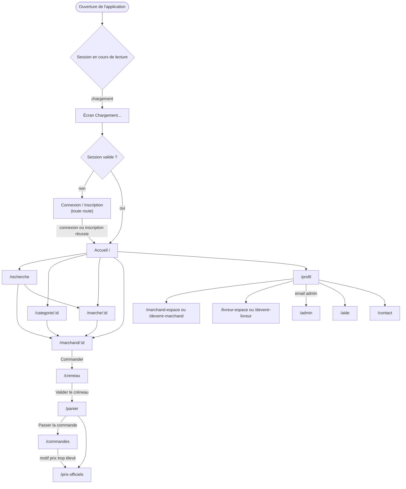
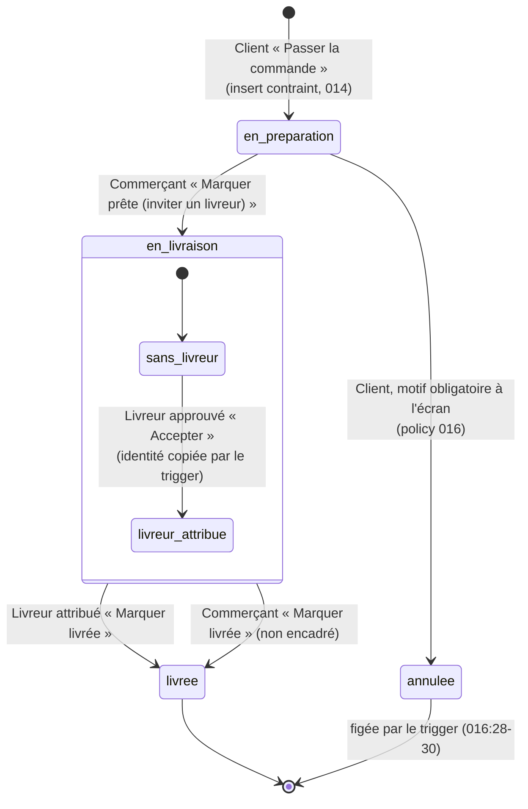
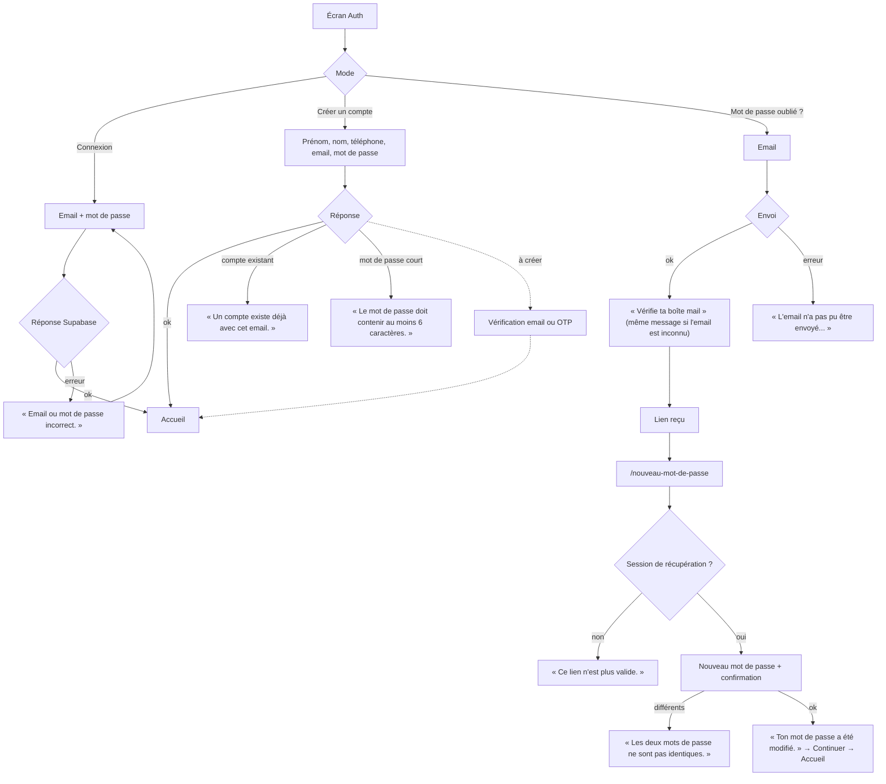
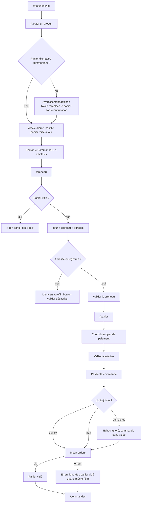
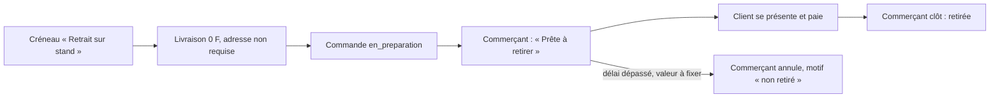
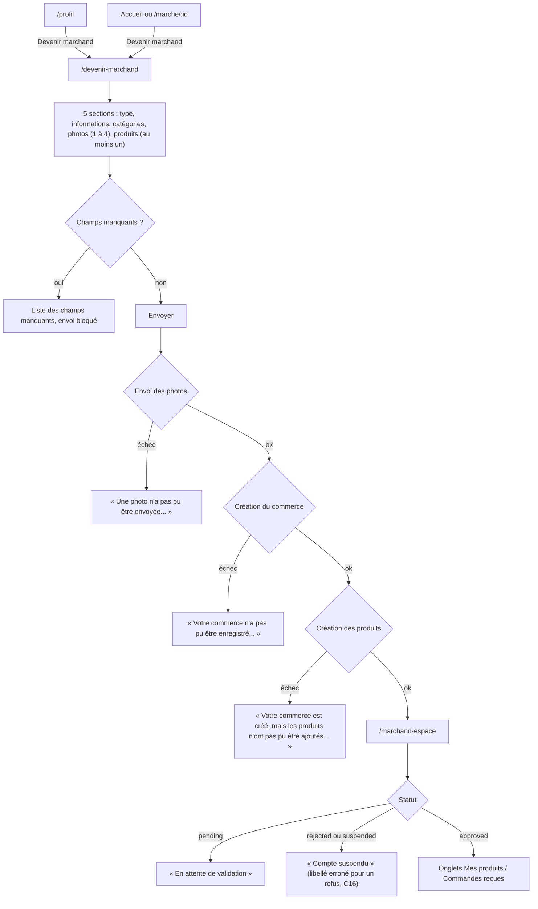
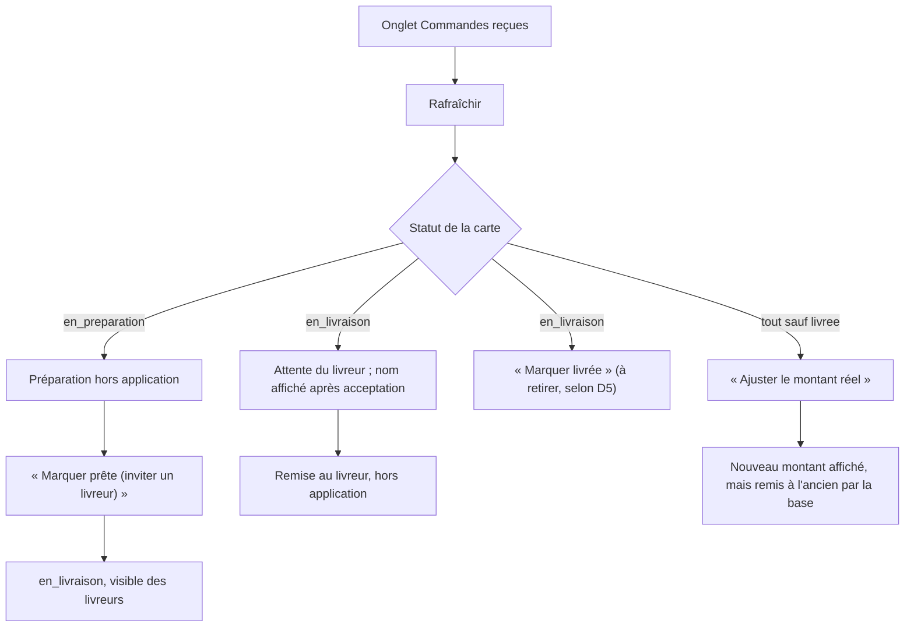
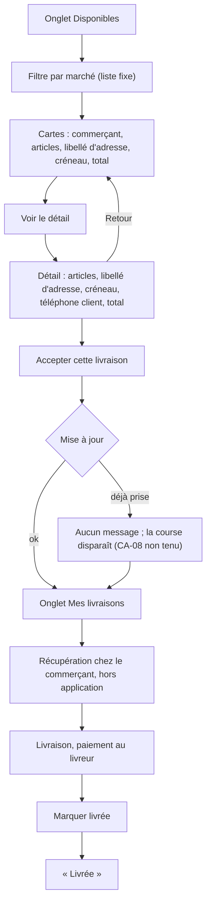
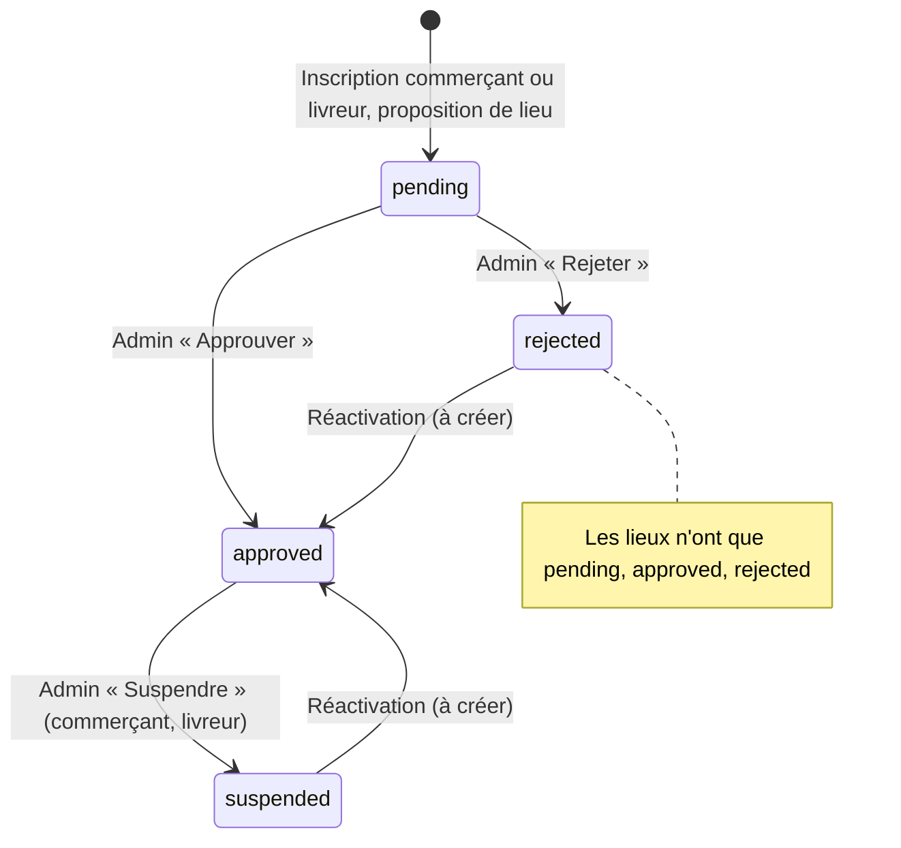

# Le Panier 241 — Parcours applicatifs (APP_FLOW)

| Élément | Valeur |
|---|---|
| Produit | Le Panier 241, marketplace mobile de commerces de proximité (Grand Libreville) |
| Version | 1.0 |
| Date | 18 octobre 2026 |
| Base de vérification | `src/App.tsx`, `src/pages/*.tsx`, `src/context/*`, `src/components/layout/*`, `supabase/schema.sql` et migrations `002` à `019`, `docs/PRD.md` |
| Public | UX, développeurs, QA, propriétaire du produit |

**Nom du produit.** Le brief parle de « Le Panier 221/241 ». Le nom validé est « Le Panier 241 » (PRD, contradiction C1). Ce document utilise uniquement « Le Panier 241 ». Plusieurs textes du code disent encore « Panier 241 » (`Cart.tsx:94`, `MerchantSpace.tsx:223`, `CourierSpace.tsx:159`).

---

## 0. Conventions

| Marque | Sens |
|---|---|
| **[Existant]** | Écran ou action présent dans le code, avec la route ou le fichier. |
| **[Partiel]** | Présent mais incomplet, contournable, ou contraire à la règle validée. |
| **[À créer]** | Aucune trace dans le code ni dans le schéma. |
| **Sans objet** | L'étape n'a pas de sens pour cet acteur. |
| **selon décision Dx** | Flux recommandé par le PRD, en attente de validation (D1 à D5, fin du PRD). |

Règles d'écriture : aucun chiffre inventé. Les montants cités viennent de `src/lib/pricing.ts`. Les délais, plafonds et seuils non fixés sont notés « valeur à fixer ».

Rappel des faits validés :

- Paiement à la livraison uniquement : Airtel Money, Moov Money, espèces. Aucun paiement en ligne.
- Un seul commerçant par panier.
- Frais de service : 5 % du sous-total.
- Livraison : 2 000 F + 300 F par km. Sans GPS : forfait de 1 500 F à la place de la partie distance, soit 3 500 F de livraison (`pricing.ts:1-3, 47`). Le brief écrit « 1500 F sans GPS » : le code ajoute ce forfait aux 2 000 F de base.
- Annulation client seulement au statut « en préparation ».
- Validation par l'administrateur des commerçants, livreurs, marchés et magasins.
- Prix officiels DGCCRF sur une page non liée depuis l'accueil : `/prix-officiels`.

---

## 1. Architecture de navigation

### 1.1 Gardes de route réelles

Il n'existe qu'une garde, la session Supabase (`src/App.tsx:76-95`). Aucune garde par rôle au niveau du routeur. Les espaces commerçant, livreur et admin se protègent eux-mêmes dans la page, puis par la RLS.

| Route | Accès sans session | Accès avec session | Contrôle de rôle | Preuve |
|---|---|---|---|---|
| `/cgu`, `/confidentialite` | Oui | Oui | Aucun | `App.tsx:89-90` |
| `/nouveau-mot-de-passe` | Oui (affiche « lien plus valide » sans session de récupération) | Oui | Aucun | `App.tsx:91`, `ResetPassword.tsx:57-67` |
| Toute autre route | Écran de connexion, l'URL est conservée | Application | Aucun au routeur | `App.tsx:92` |
| `/marchand-espace` | — | Oui | Dans la page : aucun commerce, en attente, refusé ou suspendu, approuvé | `MerchantSpace.tsx:205-252` |
| `/livreur-espace` | — | Oui | Dans la page : même logique | `CourierSpace.tsx:141-188` |
| `/admin` | — | Oui | Email administrateur codé en dur | `AdminSpace.tsx:68-80`, `AuthContext.tsx:25-29` |

Conséquences :

- Une URL profonde ouverte sans session affiche la connexion. Après connexion, la même URL s'affiche, car le routeur réévalue la route. [Existant]
- Une route inconnue avec session n'affiche que la barre de navigation : aucune page 404. [À créer]
- Pendant le chargement de la session : écran « Chargement... » (`App.tsx:79-85`). [Existant]

### 1.2 Barre de navigation

[Existant] `src/components/layout/BottomNav.tsx` : Accueil `/`, Recherche `/recherche`, Panier `/panier` (pastille du nombre d'articles), Commandes `/commandes` (pastille des commandes mises à jour), Profil `/profil`. Elle se masque au défilement vers le bas et revient à l'ajout d'un produit. Elle est présente sur tous les écrans connectés, y compris les espaces commerçant, livreur et admin.

Les espaces commerçant, livreur et admin n'ont pas d'onglet dédié : on y entre depuis le Profil.

### 1.3 Un compte, plusieurs rôles

Un même compte peut être client, commerçant et livreur (PRD §9). Un compte ne détient qu'un commerce (`maybeSingle()`, `MerchantSpace.tsx:98`) et un profil livreur (`owner_id unique`, `004`). Le rôle administrateur est réservé à un email unique (`006:4-13`).

---

## 2. Machine à états des commandes

### 2.1 État réel (code et base)

Statuts autorisés par la base : `en_preparation`, `en_livraison`, `livree`, `annulee` (`016:3-5`). L'attribution d'un livreur n'est pas un statut : c'est le remplissage de `livreur_id`.

Écarts constatés :

| Écart | Preuve | Gravité (PRD) |
|---|---|---|
| Le commerçant et le livreur peuvent écrire n'importe quel statut par requête directe. Seule l'annulation est verrouillée. | Policies `014:30-50`, trigger `016:16-70` | Moyenne (S2) |
| `en_livraison` veut dire à la fois « prête, sans livreur » et « en route ». La frise client affiche « En route » dès que la commande est prête. | `MerchantSpace.tsx:466`, `OrderProgress.tsx` | Moyenne |
| Le commerçant peut clore une livraison à la place du livreur. | `MerchantSpace.tsx:470-474` | Moyenne |
| Le retrait sur stand suit le même circuit que la livraison. | `deliverySlots.ts:7`, `CartContext.tsx:613-625` | Élevée (D2) |
| L'ajustement de montant est annulé en silence par la base. | `MerchantSpace.tsx:146-162` contre `016:37-40` | Élevée (D1) |

### 2.2 État cible (selon décisions D1, D2, D5)

```mermaid
stateDiagram-v2
    [*] --> en_preparation : Création, montants recalculés par la base (selon D3)
    en_preparation --> en_preparation : Ajustement unique avec motif, dans le plafond (selon D1)
    en_preparation --> ajustement_a_valider : Ajustement au-delà du plafond (selon D1)
    ajustement_a_valider --> en_preparation : Client accepte
    ajustement_a_valider --> annulee : Client refuse
    en_preparation --> annulee : Client, motif
    en_preparation --> annulee : Commerçant, motif (à créer)
    en_preparation --> attente_livreur : Commerçant « prête », livraison
    en_preparation --> prete_a_retirer : Commerçant « prête », retrait (selon D2)
    attente_livreur --> en_livraison : Livreur approuvé accepte
    attente_livreur --> attente_livreur : Alerte admin après délai (valeur à fixer)
    en_livraison --> livree : Livreur attribué seulement (selon D5) ; code de réception en Phase 2
    prete_a_retirer --> retiree : Commerçant, au retrait
    prete_a_retirer --> annulee : Commerçant, motif « non retiré » après délai (valeur à fixer)
    livree --> [*]
    retiree --> [*]
    annulee --> [*]
    note right of annulee : L'administrateur peut corriger tout statut, motif tracé
```

`attente_livreur` peut être un statut ou un horodatage d'acceptation (PRD §15.3). Le choix reste ouvert.

---

## 3. Permissions réelles (RLS)

Les policies d'un même type se combinent en OU.

| Table | Action | Client | Commerçant | Livreur | Admin | Preuve |
|---|---|---|---|---|---|---|
| `profiles` | lire, modifier | Le sien | Le sien | Le sien | Le sien | `schema.sql:15-21`, `014:135-139` |
| `addresses`, `favorites` | tout | Les siennes | — | — | — | `schema.sql:59-77` |
| `merchants` | lire | Approuvés | Approuvés + le sien | Approuvés | Tous | `006:21-24` |
| `merchants` | créer | Pour soi (`owner_id`) | — | — | — | `002:27-29` |
| `merchants` | modifier | — | Le sien, sans changer le statut ni le propriétaire | — | Tous, y compris le statut | `006:26-44`, `014:123-127` |
| `products` | lire | Tous | Tous | Tous | Tous | `002:53-55` |
| `products` | créer, modifier, supprimer | — | Ceux de son commerce | — | Aucune policy dédiée | `002:57-60` |
| `orders` | créer | À son nom, `en_preparation`, sans livreur | — | — | Même règle | `014:5-14` |
| `orders` | lire | Les siennes | Celles de son commerce | Disponibles (`en_livraison`, sans livreur) et les siennes, s'il est approuvé | **Aucune policy** | `002:65-70`, `014:18-28` |
| `orders` | modifier | Annuler si `en_preparation` | Celles de son commerce, statut libre, montants figés | Accepter une disponible ; modifier la sienne | Trigger le laisse tout modifier, mais aucune policy de lecture | `016:9-12`, `014:30-102` |
| `reviews` | lire | Tous | Tous | Tous | Tous | `005:16-18` |
| `reviews` | créer | Commande à lui, livrée, bon commerçant, pas son commerce | — | — | — | `014:105-120` |
| `livreurs` | lire | Approuvés | Approuvés | Approuvés + le sien | Tous | `006:50-53` |
| `livreurs` | créer, modifier | — | — | Le sien, sans changer le statut | Tous | `004:20-22`, `006:55-73` |
| `custom_markets` | lire | Approuvés + les siens | idem | idem | Tous | `015:17-19` |
| `custom_markets` | créer | `pending` seulement | idem | idem | Approuvé directement | `015:21-24` |
| `custom_markets` | valider, supprimer | — | — | — | Oui | `015:26-33` |
| `official_prices` | lire | Tous | Tous | Tous | Tous, et écriture | `016:95-102` |
| Stockage | envoyer | Dans son dossier (`user_id/…`) ; vidéo jusqu'à 50 Mo | Photos jusqu'à 5 Mo | — | — | `014:141-179` |

Points de vigilance tirés de ces règles :

- La policy de modification commerçant ne vérifie pas son statut. Un commerçant suspendu peut encore changer le statut de ses commandes par requête directe. L'écran, lui, le bloque.
- La liste « Mes livraisons » ne filtre pas sur le livreur dans le code (`CourierSpace.tsx:112`). Elle s'appuie sur la RLS. Un livreur qui est aussi client ou commerçant y voit donc aussi ses propres commandes ou celles de son commerce dès qu'un livreur y est attribué. [Partiel]
- Tous les livreurs approuvés voient le téléphone du client avant acceptation (S5).

---

## 4. Client

### 4.1 Tableau des étapes

| Étape | Statut | Route ou fichier | Comportement réel | Cible |
|---|---|---|---|---|
| Première ouverture | [Existant] | Toute route sans session → `Auth.tsx` | Logo, phrase d'accroche, onglets « Connexion » et « Créer un compte ». Pas d'écran d'accueil ou de présentation. | Inchangé au MVP. |
| Inscription | [Partiel] | `Auth.tsx`, mode `signup` ; `AuthContext.tsx:48-57` | Prénom, nom, téléphone (facultatif), email, mot de passe d'au moins 6 caractères. Profil créé par trigger (`schema.sql:24-43`). Connexion immédiate. Mention CGU passive, sans case à cocher. | Case d'acceptation et version enregistrée. |
| Connexion | [Existant] | `Auth.tsx`, mode `signin` | Email, mot de passe, « Rester connecté et se souvenir de mon email ». Proposition d'enregistrement au gestionnaire de mots de passe du navigateur. | — |
| Vérification OTP | [À créer] | — | Aucune vérification. La confirmation d'email est désactivée (PRD §10.1, `README.md`). | PRD B09 : réactiver la confirmation d'email. Un OTP par SMS n'est décidé nulle part. Décision à prendre, hors D1 à D5. |
| Mot de passe oublié | [Existant] | `Auth.tsx`, mode `forgot` → email → `/nouveau-mot-de-passe` | Message identique que le compte existe ou non. Lien à usage unique. | Mettre à jour l'URL de retour après le nom de domaine (B14). |
| Profil | [Partiel] | `/profil` | Photo, téléphone modifiable, ajout d'adresse avec GPS facultatif, compteurs commandes et favoris, moyens de paiement acceptés, liens vers les espaces. Nom non modifiable. Adresses : ajout seulement. | Modifier et supprimer une adresse, adresse par défaut, sélecteur de quartier (B20). |
| Accueil | [Existant] | `/` | « À la une », catégories, magasins, commerçants, marchés, produits à découvrir, proposer un marché ou un magasin (`AddMarketCard`). Les prix officiels n'y sont pas liés, conformément à la décision. | — |
| Recherche | [Existant] | `/recherche` | Produits, commerces, lieux, quartiers ; sans accents ; filtre catégorie ; tri par prix. Locale au catalogue chargé. | Pagination (B37). |
| Catégories | [Existant] | `/categorie/:categoryId` | Produits regroupés, « à partir de », lien vers le vendeur. | — |
| Boutique (marché ou magasin) | [Existant] | `/marche/:marketId` | Liste des commerçants du lieu. Invitation « Devenir marchand » si vide. | — |
| Boutique (commerçant) | [Existant] | `/marchand/:merchantId` | Produits avec variantes, favori, téléphone, note réelle ou « Pas encore d'avis ». | Commentaires d'avis visibles (B34). |
| Produit | [À créer] | — | Pas de fiche produit. Le produit s'ajoute depuis la carte dans la fiche commerçant. | Hors MVP. |
| Panier | [Partiel] | `/panier` | Articles, quantités, adresse, créneau, moyen de paiement, vidéo, détail du total. Panier en `sessionStorage` : perdu à la fermeture de l'onglet. | `localStorage` (B19). |
| Checkout (créneau, adresse) | [Partiel] | `/creneau` | 5 jours, matin, après-midi, soir, retrait. Adresse exigée pour valider, même en retrait. | Retrait sans adresse (selon décision D2). |
| Paiement | [Partiel] | `/panier`, section « Paiement » | Choix Airtel Money, Moov Money, Espèces. Non enregistré sur la commande. Transmis seulement dans le message WhatsApp. | Enregistré et affiché au livreur et au commerçant (B06). Circuit de l'argent selon décision D4. |
| Confirmation | [Partiel] | Redirection vers `/commandes` | Pas d'écran de confirmation. Le panier est vidé même si l'enregistrement a échoué. | Confirmation explicite ou message d'erreur, panier conservé (B07). |
| Suivi commande | [Partiel] | `/commandes`, onglet « En cours » | Frise Préparation, En route, Livrée. Nom du livreur. Rafraîchi au chargement seulement. | Rafraîchissement automatique (B27). |
| Livraison | [Partiel] | `/commandes` | Bouton « Contacter le livreur sur WhatsApp » dès qu'un livreur est attribué. | — |
| Réception | [À créer] | — | Aucune action client. Le livreur clôt seul. | Code de réception en Phase 2 (selon décision D5). |
| Évaluation | [Partiel] | `/commandes`, carte livrée | 1 à 5 étoiles et commentaire, une fois par commande livrée. Commentaires affichés nulle part. | B34. |
| Historique | [Existant] | `/commandes`, onglet « Passées » | Commandes livrées et annulées, avec motif et date d'annulation. | — |
| Notifications | [Partiel] | `BottomNav.tsx`, `Orders.tsx:303-307` | Pastille et bandeau « mises à jour depuis votre dernière visite », calculés en `localStorage`. | Matrice §8. |
| Support | [Existant] | `/aide`, `/contact` | Aide sur le calcul des prix. Contact WhatsApp et email. | Signalement sur la commande (B31). |
| Déconnexion | [Existant] | `/profil`, « Se déconnecter » | Efface panier, créneau et adresse choisie de la session, puis déconnecte. Retour à la connexion. | — |
| Suppression de compte | [À créer] | — | Sur demande par email (politique de confidentialité). | Libre-service. |

### 4.2 Flux d'authentification

### 4.3 Flux d'achat

Cible (B07, CA-02, CA-03) : bouton désactivé sans adresse en livraison ; hors connexion, message et panier conservé ; échec vidéo, choix « réessayer » ou « continuer sans » ; échec d'enregistrement, message et panier conservé.

Cas particulier : le panier vers `/creneau` est possible même sans adresse via `/panier` (`Cart.tsx:220`). Le bouton « Passer la commande » ne vérifie que le créneau (`Cart.tsx:343`). Une commande sans adresse est donc possible si l'utilisateur a choisi un créneau puis supprimé son adresse. Comme l'ajout d'adresse ne propose pas la suppression, ce cas reste rare. [Partiel]

### 4.4 Retrait sur stand (selon décision D2, option A)

État réel : la livraison est facturée, l'adresse est exigée, la commande part chez les livreurs. [Partiel]

### 4.5 Ajustement du montant vu par le client (selon décision D1, option B)

État réel : le panier annonce « le montant réel peut varier et sera ajusté par le commerçant » (`Cart.tsx:313`). Aucun ajustement n'aboutit. Le client ne voit jamais d'écart. [Partiel]

Cible : sur la carte de commande, ancien montant, nouveau montant et motif. Au-delà du plafond (valeur à fixer), boutons « Accepter » et « Refuser ». Refuser annule la commande.

### 4.6 Annulation

[Existant] `/commandes`, carte au statut « En préparation » : « Annuler la commande » → quatre motifs → « Garder » ou « Confirmer l'annulation ». Avec le motif « Le prix est trop élevé », lien vers `/prix-officiels`.

Erreur : si la commande vient de passer en livraison, message « La commande n'a pas pu être annulée : elle est peut-être déjà en livraison. » (`OrdersContext.tsx:139`). Le bouton reste affiché jusqu'au prochain chargement.

Après annulation : statut « Annulée », date fixée par la base, total « non dû ». Le commerçant n'est pas prévenu. [Partiel]

### 4.7 États hors connexion

| Situation | Réel | Cible |
|---|---|---|
| Bandeau | [Existant] « Hors connexion : les informations affichées peuvent ne pas être à jour. » (`OfflineBanner.tsx`) | — |
| Envoi de commande | [Partiel] Aucun blocage ; erreur ignorée ; panier vidé | Blocage explicite, panier conservé (P0) |
| Catalogue | [Existant] Message d'erreur via `CatalogState` sur l'accueil et les fiches | — |
| Panier | [Partiel] Survit au rechargement, pas à la fermeture de l'onglet | `localStorage` (P1) |
| Application installable, cache | [À créer] | PWA (P3) |

---

## 5. Commerçant

### 5.1 Étapes communes

| Étape | Statut | Détail |
|---|---|---|
| Première ouverture, inscription au compte, connexion, mot de passe oublié, déconnexion | Identiques au client (§4.1) | Le commerçant crée d'abord un compte client. |
| Vérification OTP | [À créer] | Comme pour le client. |
| Profil | [Existant] | `/profil` : bouton « Devenir marchand » ou « Mon espace marchand », suffixé « (en attente) », « (suspendu) » ou « (refusé) » (`Profile.tsx:84-88, 392-403`). |
| Accueil, recherche, catégories, boutique, panier, checkout, paiement, suivi, évaluation | Identiques au client | Le commerçant peut acheter comme un client. Il ne peut pas noter son propre commerce (`014:117-119`). |
| Produit (fiche publique) | [À créer] | Comme pour le client. |
| Notifications | [À créer] | Aucune. Bouton « Rafraîchir » manuel. |
| Support | [Partiel] | `/aide`, `/contact`. Le message de suspension renvoie vers « l'administrateur » sans lien. |

### 5.2 Inscription et vérification

| Étape | Statut | Détail |
|---|---|---|
| Inscription commerce | [Existant] | `/devenir-marchand` (`BecomeMerchant.tsx`). Photos compressées avant envoi. Retour vers `/`. |
| Vérification | [Partiel] | Validation manuelle par l'admin, qui ne voit que le nom et l'adresse (`AdminSpace.tsx:39`). Aucun justificatif demandé. Le commerçant n'est pas prévenu : il doit revenir sur son espace. |
| Message d'erreur E3 | [Partiel] | Le texte renvoie à l'espace marchand, mais l'espace est bloqué tant que le commerce est en attente. |
| Création boutique | [Existant] | Elle se fait dans le même formulaire que l'inscription. Pas de modification ensuite. |
| Modifier la fiche commerce | [À créer] | Téléphone, photos, horaires (PRD §17.2, P1). |
| Justificatif (registre, carte de vendeur) | [À créer] | PRD §17.1. |

### 5.3 Gestion du catalogue

| Étape | Statut | Détail |
|---|---|---|
| Ajout produits | [Existant] | Onglet « Mes produits » : nom, catégorie, prix, unité, variante, photo (`MerchantSpace.tsx:169-198`). Photo non compressée. Échec de photo ignoré. |
| Supprimer un produit | [Existant] | Sans confirmation (`MerchantSpace.tsx:200-203`). |
| Modifier un produit | [À créer] | Changer un prix oblige à supprimer puis recréer (B15, P1). |
| Gestion stock | [À créer] | Aucune quantité ni disponibilité. Cible : « indisponible » sans suppression (P1). |
| Prix officiel ou prix du magasin | [À créer] | Indication par prix et alerte au-delà du plafond DGCCRF (B32, P2). |
| Promotions | [À créer] | Règles cibles PRD §12.8, Phase 2. Réduction calculée par la base. |

### 5.4 Traitement des commandes

| Étape | Statut | Détail |
|---|---|---|
| Réception commande | [Partiel] | Liste avec créneau, libellé d'adresse, articles, total, vidéo. Rafraîchissement manuel. Aucun signal. Le moyen de paiement n'apparaît pas. |
| Préparation | [Partiel] | Aucune action dédiée. La commande reste « En préparation » jusqu'au clic « Marquer prête ». |
| Remise au livreur | [Partiel] | Aucune action. Le commerçant voit le nom du livreur, pas son téléphone. |
| Ajustement du montant | [Partiel] | Inopérant (D1). Bouton affiché aussi sur une commande annulée. |
| Ajustement cible | selon décision D1 | Une fois, avant le départ, avec motif ; plafond (valeur à fixer) ; au-delà, accord du client ; ancien montant conservé. |
| Refuser ou annuler | [À créer] | Motif obligatoire (B17, P1). |
| Marquer livrée | [Partiel] | Possible pour toute commande `en_livraison`, même sans livreur. Cible : réservé au livreur attribué (selon décision D5). |
| Retrait | selon décision D2 | « Prête à retirer », puis « Retirée » par le commerçant. |

Erreurs non signalées à l'écran :

- Mise à jour du statut : l'écran change avant la réponse de la base, sans vérification (`MerchantSpace.tsx:136-139`). Si le client a annulé entre-temps, la base garde « annulée » et l'écran affiche « en livraison » jusqu'au prochain rafraîchissement.
- Ajout de produit : erreur d'insertion ignorée.

### 5.5 Statistiques, commissions, avis

| Élément | Statut | Détail |
|---|---|---|
| Statistiques (ventes, revenus) | [À créer] | Aucune vue. KPI calculables en base (PRD §23). |
| Avis reçus | [À créer] | Note visible sur la fiche publique seulement. |
| Commissions | [À créer] | Aucune commission prélevée. Relevé périodique cible, taux non fixé (PRD §17.5). |
| Encaissement et reversement | selon décision D4 | Recommandation : le client paie le commerçant par mobile money à la préparation (C) ; repli, le livreur collecte pour le commerçant (B). |

---

## 6. Livreur

### 6.1 Étapes communes

| Étape | Statut | Détail |
|---|---|---|
| Première ouverture, inscription au compte, connexion, mot de passe oublié, déconnexion | Identiques au client | — |
| Vérification OTP | [À créer] | Comme pour le client. |
| Profil | [Existant] | « Devenir livreur » ou « Mon espace livreur » avec suffixe de statut. |
| Accueil, recherche, catégories, boutique, produit, panier, checkout, paiement client | Identiques au client | Le livreur peut acheter comme un client. |
| Notifications | [À créer] | Aucune. Bouton « Rafraîchir » manuel. |
| Support | [Partiel] | `/aide`, `/contact`. |

### 6.2 Inscription et validation

| Étape | Statut | Détail |
|---|---|---|
| Inscription | [Existant] | `/devenir-livreur` : nom, téléphone, véhicule (Moto, Vélo, Voiture, À pied). Puis `/livreur-espace`. Erreur brute de la base affichée en cas d'échec. |
| Validation documents | [À créer] | Aucun document. Cible Phase 2 : pièce d'identité, photo, permis et document du véhicule si motorisé, numéro mobile money ; bucket privé ; date d'expiration (PRD §18.4). |
| Validation admin | [Existant] | « En attente de validation », puis espace actif. Refus affiché comme « Compte suspendu » (C16). |
| Disponibilité | [À créer] | Pas de statut en service ou hors service, pas de zone (P2). |

### 6.3 Course

| Étape | Statut | Détail |
|---|---|---|
| Réception mission | [Partiel] | Liste à la demande. Aucune alerte. Gain non affiché, seulement le total (`CourierSpace.tsx:253, 314`). |
| Acceptation | [Existant] | Premier arrivé, identité imposée par la base (`014:81-93`). |
| Refus | Sans objet | Le livreur ignore la course. Aucune action « refuser » n'est prévue ni nécessaire. |
| Acceptation concurrente | [Partiel] | Échec silencieux. Cible : « Course déjà prise » et liste rafraîchie. |
| Navigation | [À créer] | Aucune adresse complète ni GPS (`Cart.tsx:132-134`). Cible : adresse, repère, coordonnées, lien d'itinéraire après acceptation (B05, B22). |
| Récupération | [À créer] | Aucune action. Le téléphone du commerçant n'est pas affiché dans l'espace livreur. |
| Preuve de départ | [À créer] | Aucune. Cible possible : horodatage « récupérée » (B26). Non décidé. |
| Livraison | [Partiel] | Contact client par appel (`tel:`). Moyen de paiement inconnu du livreur (B06). |
| Validation client | [À créer] | Code de réception à 4 chiffres en Phase 2 ; repli photo ou appel au support (selon décision D5). |
| Clôture | [Partiel] | « Marquer livrée », sans preuve, sans montant encaissé. Cible : montant et moyen réellement encaissés (PRD §14.3). |
| Gains, historique | [Partiel] | « Mes livraisons » sans totaux ni gains. Circuit de rémunération selon décision D4. |

Données affichées avant et après acceptation (cible CA-09) :

| Information | Avant (réel) | Avant (cible) | Après (cible) |
|---|---|---|---|
| Lieu de retrait | Nom du commerçant | Nom et lieu | Nom, lieu, téléphone |
| Destination | Libellé · quartier, ville | Quartier, distance | Adresse complète, repère, lien d'itinéraire |
| Téléphone client | Visible | Masqué | Visible |
| Montant | Total | Gain estimé | Gain, total à encaisser, moyen de paiement |

---

## 7. Administrateur

### 7.1 Étapes communes

| Étape | Statut | Détail |
|---|---|---|
| Première ouverture, connexion, mot de passe oublié, déconnexion | Identiques au client | Pas de connexion dédiée. |
| Inscription | Sans objet | Rôle attaché à un email codé en dur (`006:4-13`). Cible : table de rôles (B09). |
| Vérification OTP | [À créer] | Prioritaire pour ce compte (S3). |
| Accès à l'espace | [Existant] | `/profil` → « Espace admin » si l'email correspond. Sinon `/admin` affiche « Accès réservé à l'administrateur » et « Retour à l'accueil ». |
| Achat, suivi, évaluation | Identiques au client | — |
| Notifications | [À créer] | Aucune alerte de demande en attente. |

### 7.2 Écran existant

[Existant] `/admin` (`AdminSpace.tsx`), une seule page avec « Rafraîchir » :

1. Marchands en attente : nom, adresse, « Approuver », « Rejeter ».
2. Marchés et magasins proposés : logo ou photo, type, quartier, « Approuver », « Rejeter ».
3. Livreurs en attente : nom, téléphone, véhicule, « Approuver », « Rejeter ».
4. Marchands actifs : « Suspendre ».
5. Livreurs actifs : « Suspendre ».

Aucune confirmation avant une action. Aucune erreur affichée.

### 7.3 Fonctions

| Fonction | Statut | Détail ou cible |
|---|---|---|
| Dashboard | [À créer] | KPI de PRD §23. Aujourd'hui, calcul par SQL dans la console Supabase. |
| Utilisateurs | [À créer] | Aucune liste des comptes clients. |
| Vendeurs | [Partiel] | Validation et suspension. Dossier complet (photos, produits, type, quartier) et réactivation à créer (B18). |
| Livreurs | [Partiel] | Validation et suspension. Documents (B30) et réactivation à créer. |
| Marchés et magasins | [Existant] | Validation des propositions. Ajout direct approuvé par l'admin (`MarketsContext.tsx:89, 119`). |
| Produits | [À créer] | Aucune modération. |
| Avis | [À créer] | Aucune modération. |
| Commandes | [À créer] | Aucune policy de lecture admin sur `orders` (B10, P0). Cible : liste filtrable par statut, correction et annulation avec motif tracé. |
| Paiements | [À créer] | Aucun encaissement en ligne. Suivi des encaissements déclarés selon décision D4. |
| Commissions | [À créer] | Aucune commission. Relevés après décision (PRD §17.5). |
| Publicités | [À créer] | Hors MVP. Mise en avant « sponsorisée », non ciblée (PRD §17.6, Phase 3). |
| Litiges | [À créer] | MVP : contact WhatsApp et email, correction admin. Phase 2 : « Signaler un problème », file admin, statuts (PRD §19.2). |
| Statistiques | [À créer] | Voir Dashboard. |
| Paramètres | [À créer] | Barème en base (selon décision D3), prix officiels (écriture déjà autorisée, `016:99-102`, sans écran), délais et plafonds (valeurs à fixer). |

---

## 8. Notifications

### 8.1 Réel

| Canal | Statut | Acteur |
|---|---|---|
| Pastille « Commandes » dans la barre | [Existant] | Client. Compare les statuts vus, stockés en `localStorage` par compte. |
| Bandeau « Une ou plusieurs commandes ont été mises à jour... » | [Existant] | Client, à l'arrivée sur `/commandes`. |
| Pastille « Panier » | [Existant] | Tous. |
| Rafraîchissement automatique | [À créer] | Aucun abonnement temps réel. |
| Push, SMS, email transactionnel | [À créer] | — |
| Liens WhatsApp manuels | [Existant] | Client vers commerçant (panier), client vers livreur (commande), tous vers le support (contact). |

### 8.2 Cible (PRD §20.2, Phase 2)

| Événement | Client | Commerçant | Livreur | Admin |
|---|---|---|---|---|
| Nouvelle commande | — | Oui | — | — |
| Annulation par le client | — | Oui | Si attribuée | — |
| Commande prête | — | — | Livreurs approuvés (zone) | — |
| Livreur attribué | Oui | Oui | — | — |
| Montant ajusté (selon D1) | Oui | — | Oui | — |
| Commande livrée | Oui | Oui | — | — |
| Sans livreur après délai (valeur à fixer) | — | Oui | — | Oui |
| Demande d'inscription en attente | — | — | — | Oui |
| Compte validé ou refusé | — | Oui | Oui | — |

---

## 9. Inventaire des écrans

Les écrans partagés (connexion, profil, aide, contact, pages légales) sont comptés une fois, dans la colonne Client. Les onglets d'un même écran sont comptés comme écrans quand ils portent un parcours distinct.

| Acteur | Écrans existants (dont partiels) | Écrans à créer |
|---|---|---|
| Client | 16 : Auth (connexion, inscription, oubli), Nouveau mot de passe, Accueil, Recherche, Catégorie, Marché ou magasin, Fiche commerçant, Créneau, Panier, Mes commandes, Profil, Prix officiels, Aide, Contact, CGU, Confidentialité | 8 : Vérification email ou OTP, Fiche produit, Confirmation de commande, Centre de notifications, Liste des favoris, Signalement de problème, Page 404, Suppression de compte |
| Commerçant | 4 : Devenir marchand, Espace en attente ou suspendu, Mes produits, Commandes reçues | 7 : Modifier un produit, Modifier la fiche commerce, Statistiques, Relevé de commissions, Promotions, Avis reçus, Justificatifs |
| Livreur | 5 : Devenir livreur, Espace en attente ou suspendu, Disponibles, Détail de course, Mes livraisons | 5 : Documents, Course acceptée (adresse, itinéraire, paiement), Clôture (code, montant encaissé), Relevé de gains, Disponibilité et zone |
| Administrateur | 2 : Espace admin (validations et suspensions), Accès refusé | 12 : Dashboard, Utilisateurs, Dossier commerçant, Livreurs et documents, Produits et avis, Commandes, Paiements, Commissions, Publicités, Litiges, Prix officiels, Paramètres |

---

## 10. MATRICE

| Acteur | Écran | Action | Écran suivant | Condition | Erreur possible |
|---|---|---|---|---|---|
| Tous | Chargement | Ouverture | Auth ou Accueil `/` | Session lue | — |
| Tous | Auth `[Existant]` | Se connecter | Accueil `/` ou URL demandée | Email et mot de passe valides | « Email ou mot de passe incorrect. » |
| Tous | Auth `[Existant]` | Créer mon compte | Accueil `/` | Champs requis, mot de passe d'au moins 6 caractères | « Un compte existe déjà avec cet email. » ; mot de passe trop court |
| Tous | Auth `[À créer]` | Saisir le code de vérification | Accueil `/` | Code valide | Code expiré ou erroné |
| Tous | Auth `[Existant]` | Envoyer le lien (oubli) | Auth « Vérifie ta boîte mail » | Email saisi | « L'email n'a pas pu être envoyé... » |
| Tous | `/nouveau-mot-de-passe` `[Existant]` | Enregistrer | Message de succès → Accueil | Lien valide, deux saisies identiques | « Ce lien n'est plus valide. » ; « Les deux mots de passe ne sont pas identiques. » |
| Tous | `/profil` `[Existant]` | Se déconnecter | Auth | — | — |
| Client | Accueil `[Existant]` | Toucher la recherche | `/recherche` | — | — |
| Client | Accueil `[Existant]` | Toucher une catégorie | `/categorie/:id` | — | « Catégorie introuvable. » et retour à l'accueil |
| Client | Accueil `[Existant]` | Toucher un marché ou un magasin | `/marche/:id` | Lieu approuvé | « Marché introuvable. » et retour à l'accueil |
| Client | Accueil `[Existant]` | Proposer un marché ou un magasin | Accueil, proposition `pending` | Magasin : logo obligatoire | « Ajoutez le logo du magasin ou de l'enseigne. » |
| Client | `/recherche` `[Existant]` | Ouvrir un résultat | `/marchand/:id` ou `/marche/:id` | — | Aucun résultat |
| Client | `/marchand/:id` `[Existant]` | Ajouter un produit | Même écran | — | Panier d'un autre commerçant remplacé (avertissement, sans confirmation) |
| Client | `/marchand/:id` `[Existant]` | Ajouter aux favoris | Même écran | — | — |
| Client | `/marchand/:id` `[Existant]` | Commander | `/creneau` | Panier non vide chez ce commerçant | — |
| Client | `/creneau` `[Existant]` | Valider le créneau | `/panier` | Créneau et adresse choisis | Pas d'adresse : bouton désactivé, lien vers `/profil` |
| Client | `/creneau` `[Partiel]` | Choisir « Retrait sur stand » | `/panier` | Adresse exigée quand même | Livraison facturée (D2) |
| Client | `/panier` `[Existant]` | Choisir le moyen de paiement | Même écran | Airtel Money, Moov Money ou Espèces | Non enregistré sur la commande |
| Client | `/panier` `[Existant]` | Comparer avec les prix officiels | `/prix-officiels` | — | « Les prix n'ont pas pu être chargés. Vérifiez votre connexion. » |
| Client | `/panier` `[Partiel]` | Passer la commande | `/commandes` | Créneau choisi | Échec ignoré, panier vidé ; vidéo perdue en silence |
| Client | `/panier` `[Existant]` | Envoyer aussi via WhatsApp | WhatsApp externe | Téléphone du commerçant connu | — |
| Client | `/commandes` `[Existant]` | Annuler la commande | Même écran, statut « Annulée » | Statut `en_preparation`, motif choisi | « ...elle est peut-être déjà en livraison. » |
| Client | `/commandes` `[Existant]` | Contacter le livreur | WhatsApp externe | Livreur attribué, commande non close | — |
| Client | `/commandes` `[Partiel]` | Laisser un avis | Même écran, « Merci pour votre avis » | Statut `livree`, pas d'avis existant | Message brut de la base si refus |
| Client | `/commandes` `[À créer]` | Accepter ou refuser un ajustement | Même écran | Ajustement au-delà du plafond (selon D1) | Délai de réponse dépassé (valeur à fixer) |
| Client | `/commandes` `[À créer]` | Afficher le code de réception | Même écran | Livreur attribué (selon D5, Phase 2) | Client sans téléphone : repli support |
| Client | `/commandes` `[À créer]` | Signaler un problème | Signalement | Commande existante | Envoi impossible hors connexion |
| Client | `/profil` `[Existant]` | Ajouter une adresse | Même écran | Nom, adresse, quartier | GPS refusé : forfait de livraison |
| Client | `/profil` `[Existant]` | Modifier le téléphone | Même écran | Champ non vide | Erreur d'enregistrement non affichée |
| Client | `/profil` `[Existant]` | Changer la photo | Même écran | JPEG, PNG ou WebP | « La photo n'a pas pu être envoyée. » |
| Client | `/profil` `[Existant]` | Aide, Contact, CGU, Confidentialité | `/aide`, `/contact`, `/cgu`, `/confidentialite` | — | — |
| Commerçant | `/profil` `[Existant]` | Devenir marchand | `/devenir-marchand` | Aucun commerce lié au compte | — |
| Commerçant | `/devenir-marchand` `[Existant]` | Envoyer la demande | `/marchand-espace` (en attente) | Champs obligatoires, 1 à 4 photos, au moins un produit | Photo non envoyée ; commerce non enregistré ; produits non ajoutés |
| Commerçant | `/marchand-espace` `[Existant]` | Ouvrir l'espace | En attente, suspendu ou onglets | Selon le statut | Refus affiché « Compte suspendu » |
| Commerçant | Mes produits `[Existant]` | Ajouter un produit | Même onglet | Nom, prix, unité | Échec d'insertion ou de photo non signalé |
| Commerçant | Mes produits `[Existant]` | Supprimer un produit | Même onglet | — | Aucune confirmation |
| Commerçant | Mes produits `[À créer]` | Modifier un produit ou le marquer indisponible | Même onglet | Produit à soi | — |
| Commerçant | Commandes reçues `[Existant]` | Rafraîchir | Même onglet | — | Hors connexion : liste ancienne |
| Commerçant | Commandes reçues `[Existant]` | Marquer prête (inviter un livreur) | Même onglet, `en_livraison` | Statut `en_preparation` | Commande annulée entre-temps : écran faux jusqu'au rafraîchissement |
| Commerçant | Commandes reçues `[À créer]` | Marquer prête à retirer | Même onglet | Créneau retrait (selon D2) | — |
| Commerçant | Commandes reçues `[Partiel]` | Ajuster le montant réel | Même onglet | Statut différent de `livree` | Montant remis à l'ancien par la base, sans message (D1) |
| Commerçant | Commandes reçues `[Partiel]` | Marquer livrée | Même onglet, `livree` | Statut `en_livraison` | Clôture sans livreur possible (à retirer, selon D5) |
| Commerçant | Commandes reçues `[À créer]` | Annuler avec motif | Même onglet, `annulee` | Statut `en_preparation` | — |
| Commerçant | Commandes reçues `[Existant]` | Voir la vidéo | Lecteur externe | Vidéo jointe | URL publique (S4) |
| Livreur | `/profil` `[Existant]` | Devenir livreur | `/devenir-livreur` | Aucun profil livreur | — |
| Livreur | `/devenir-livreur` `[Existant]` | Envoyer | `/livreur-espace` (en attente) | Nom, téléphone, véhicule | Message brut de la base |
| Livreur | `/livreur-espace` `[À créer]` | Déposer les documents | Même écran | Pièces requises selon véhicule | Fichier trop lourd ; pièce expirée |
| Livreur | Disponibles `[Existant]` | Filtrer par marché | Même onglet | — | Lieux ajoutés absents du filtre |
| Livreur | Disponibles `[Existant]` | Voir le détail | Détail de course | Livreur approuvé | — |
| Livreur | Détail de course `[Existant]` | Accepter cette livraison | Mes livraisons | Course sans livreur | Course déjà prise : aucun message |
| Livreur | Détail de course `[Existant]` | Appeler le client | Appel téléphonique | Numéro renseigné | « Numéro non renseigné. » |
| Livreur | Course acceptée `[À créer]` | Ouvrir l'itinéraire | Application de cartes | Coordonnées présentes | Sans GPS : adresse et repère seulement |
| Livreur | Mes livraisons `[Partiel]` | Marquer livrée | Même onglet, « Livrée » | Livreur attribué, `en_livraison` | Aucune preuve ; erreur non affichée |
| Livreur | Clôture `[À créer]` | Saisir le code et le montant encaissé | Mes livraisons | Code correct (selon D5) | Code erroné trois fois : blocage et alerte admin |
| Admin | `/profil` `[Existant]` | Espace admin | `/admin` | Email administrateur | — |
| Admin | `/admin` `[Existant]` | Ouvrir sans droit | Accès refusé → Accueil | Email différent | « Accès réservé à l'administrateur » |
| Admin | `/admin` `[Existant]` | Approuver ou rejeter un marchand | Même écran | Statut `pending` | Erreur non affichée ; dossier incomplet visible |
| Admin | `/admin` `[Existant]` | Approuver ou rejeter un lieu | Même écran | Statut `pending` | Erreur non affichée |
| Admin | `/admin` `[Existant]` | Approuver ou rejeter un livreur | Même écran | Statut `pending` | Erreur non affichée |
| Admin | `/admin` `[Existant]` | Suspendre un marchand ou un livreur | Même écran | Statut `approved` | Aucune confirmation ; pas de réactivation |
| Admin | Commandes `[À créer]` | Lister, corriger, annuler | Détail de commande | Rôle admin en base (B09, B10) | Motif obligatoire manquant |
| Admin | Dashboard `[À créer]` | Consulter les KPI | Dashboard | Rôle admin | Données insuffisantes avant quatre semaines |
| Admin | Prix officiels `[À créer]` | Mettre à jour un prix | Même écran | Rôle admin | Source ou date manquante |
| Admin | Litiges `[À créer]` | Traiter un signalement | Détail du litige | Signalement ouvert | — |
