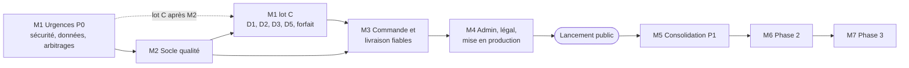

# Le Panier 241 — Plan de développement (DEV_PLAN)

| Élément | Valeur |
|---|---|
| Produit | Le Panier 241, marketplace mobile de commerces de proximité (Grand Libreville) |
| Version du document | 1.0 |
| Date | 18 octobre 2026 |
| Rôle de l'auteur | Engineering Manager et Technical Project Manager |
| Sources lues | `docs/PRD.md` (backlog B01 à B41, décisions D1 à D5), `docs/APP_FLOW.md`, `docs/UI_UX.md`, `docs/SECURITY_REQUIREMENTS.md` (checklist de mise en production), `PROJECT_CONVENTIONS.md`, `AI_RULES.md`, `package.json`, `supabase/schema.sql` et migrations `002` à `019` |
| Public | Propriétaire du produit, développeurs, agents IA, QA |

**Nom du produit.** Le brief parle de « Le Panier 221/241 ». Le nom validé est « Le Panier 241 » (PRD, contradiction C1). Ce document n'utilise que ce nom.

**Documents absents.** Il n'existe ni TRD (`docs/TRD.md`) ni document Backend. Les faits techniques de ce plan sont tirés directement du code et des migrations. Aucun TRD n'est créé ici ; sa rédaction est prévue par la tâche M2-08.

**Faits techniques retenus (lus dans le code).**

| Sujet | Constat | Preuve |
|---|---|---|
| Front | React 18, Vite 5, TypeScript strict, Tailwind 3, React Router 6 ; état global par contextes | `package.json`, `src/context/*` |
| Backend | Pas de serveur applicatif. Le navigateur parle directement à PostgREST avec la clé anonyme. Toute règle est portée par la RLS, des contraintes, des triggers et des fonctions SQL. | `src/lib/supabaseClient.ts`, `supabase/*.sql` |
| Fonction serveur | Une seule fonction Vercel, proxy Pexels avec clé côté serveur | `api/pexels.ts` |
| Administrateur | `is_admin()` compare l'email de `auth.users` à une adresse codée en dur ; même adresse dans le bundle front | `006:4-13`, `src/context/AuthContext.tsx:25-29` |
| Approbation | Triggers `BEFORE UPDATE` seulement ; les policies d'insertion vérifient uniquement `owner_id = auth.uid()` | `006:30-73`, `002:27-29`, `004:20-22` |
| Commandes | Insertion contrainte (`en_preparation`, sans livreur) ; colonnes financières figées par `protect_order_columns()` ; statut libre pour commerçant et livreur | `014:5-102`, `016:9-70` |
| Montants | Calculés dans le navigateur (`computeDelivery`) puis envoyés tels quels à l'insertion | `src/lib/pricing.ts:39-56`, `src/context/CartContext.tsx:101`, `src/context/OrdersContext.tsx:94-128` |
| Coordonnées | Celles des 4 lieux fixes n'existent que dans le front ; les adresses ont `lat`/`lng` en base | `src/data/markets.ts`, `007:4-5` |
| Vérification disponible | Seulement `npm run build` (`tsc -b && vite build`). Ni lint, ni tests, ni CI. | `package.json`, `AI_RULES.md` R35-R38 |
| Déploiement | Push sur `main` → production Vercel. Migrations exécutées à la main dans l'éditeur SQL Supabase, sans suivi automatique. | `PROJECT_CONVENTIONS.md` §21, §30 |
| Prochaine migration | `020_...` | `AI_RULES.md` R53 |

**Règles de ce plan.**

- Aucune durée n'est estimée. L'ordre et les dépendances remplacent le calendrier.
- Statuts : « À faire », « Bloquée par décision Dx » (la tâche ne peut pas démarrer tant que le propriétaire n'a pas tranché), « Fait » (seulement avec preuve dans le code). Aucune tâche de ce plan n'est marquée « Fait » : les acquis déjà en place sont listés au §3.1 avec leur preuve.
- Priorités : P0 bloquant pour le lancement public, P1 essentiel, P2 important (Phase 2), P3 amélioration (Phase 3).
- Ce plan ne tranche aucune décision D1 à D5 (`AI_RULES.md` R6). Il indique ce que chaque option implique.
- Toute tâche qui touche la base passe par une migration `supabase/020_...` ou suivante (R53), avec test RLS pour chaque rôle touché (EX-02).
- `AI_RULES.md` R38 interdit d'ajouter ESLint, Vitest ou un autre outil sans autorisation : le milestone M2 commence par cette autorisation (M2-01).

---

## 1. Vision

Le Panier 241 permet à un client de Libreville de commander chez un commerçant de marché ou un magasin de proximité, d'être livré par un livreur indépendant et de payer à la réception (espèces, Airtel Money, Moov Money). Le produit existe et tourne en production (`https://panier241.vercel.app`). Il n'est pas prêt pour un lancement public : les audits ont trouvé une faille d'auto-approbation exploitable avec la clé publique, des montants fixés par le navigateur, des transitions de statut libres, des promesses (ajustement de montant, retrait sans frais) que la base contredit, et des données fictives.

Vision technique de ce plan :

1. **D'abord fermer les failles et assainir les données**, sans attendre les décisions produit.
2. **Puis se donner les moyens de vérifier** (lint, tests de calcul, tests RLS, recette mobile), parce que les chantiers suivants modifient les montants et les droits.
3. **Ensuite déplacer la vérité dans la base** (montants, statuts, droits), selon les décisions du propriétaire.
4. **Enfin seulement**, ajouter des fonctionnalités (Phase 2, Phase 3).

Le MVP est l'application actuelle corrigée des écarts bloquants, sans nouvelle grande fonctionnalité (PRD §24).

---

## 2. Architecture des phases

| Phase | Milestones | Objectif | Sortie |
|---|---|---|---|
| MVP (lancement public) | M1 Urgences P0, M2 Socle qualité, M3 Commande et livraison fiables, M4 Administration, légal, mise en production | Tous les P0 livrés et vérifiés | Checklist critique de `SECURITY_REQUIREMENTS.md` §6 cochée avec preuves ; CA-01 à CA-16 validés |
| Consolidation | M5 | Éléments P1 des semaines qui suivent le lancement | B15 à B26 livrés, dette de configuration traitée |
| Phase 2 | M6 | Fiabilité opérationnelle et confiance (PRD §25) | Notifications, code de réception, paiement intégré si D3 et D4 le permettent |
| Phase 3 | M7 | Croissance (PRD §26) | Selon les mesures de la Phase 2 |



**Organisation de M1.** Les audits imposent de placer en P0 dans le premier milestone les failles confirmées et les sujets D1, D2, D3, D5 et le forfait. Ces derniers sont des chantiers qui modifient les montants et les droits : ils ne doivent pas démarrer sans tests. M1 est donc découpé en trois lots :

- **Lot A** (M1-01 à M1-09) : correctifs sans décision, livrables immédiatement, vérifiés par des requêtes SQL en transaction annulée exécutées à la main.
- **Lot B** (M1-10) : recueil des décisions par le propriétaire, en parallèle du lot A.
- **Lot C** (M1-11 à M1-15) : mise en œuvre des décisions. Porte d'entrée : décision prise **et** M2-03 et M2-04 terminés.

---

## 3. MVP

### 3.1 Acquis vérifiés dans le code (non replanifiés)

| Acquis | Preuve |
|---|---|
| RLS active, policies séparées par rôle | `002`, `004`, `014` |
| Commande créée seulement `en_preparation`, sans livreur, au nom du client | `014:5-14` |
| Montants, articles, adresse, créneau, téléphone et vidéo figés après création (hors admin) | `014:54-102`, `016:16-70` |
| Annulation client seulement `en_preparation` ; `annulee` figée ; date d'annulation fixée par la base | `016:9-12, 28-30, 46-51` |
| Identité du livreur imposée par la base à l'acceptation | `014:81-93` |
| Avis : commande livrée, bon commerçant, pas d'auto-notation, un par commande | `005`, `014:104-120` |
| Statut commerçant et livreur non modifiable par son propriétaire (mise à jour) | `006:30-73` |
| Marchés proposés créés `pending` sauf admin | `015:21-24` |
| Stockage : écriture dans son dossier, tailles et types bornés, pas de listing public | `014:141-179` |
| En-têtes HTTP stricts, clé Pexels côté serveur | `vercel.json`, `api/pexels.ts` |

### 3.2 Milestone M1 — Urgences P0 : sécurité, données fictives, arbitrages

**Objectif.** Fermer les failles confirmées, retirer les données fictives, faire trancher les décisions D1 à D5, le forfait sans GPS et l'OTP, puis appliquer ces décisions dans la base.

**Fonctionnalités.** Aucune nouvelle fonctionnalité. Correctifs de droits, assainissement des données, réglages d'authentification, règles serveur de montants et de statuts.

**Porte d'entrée (à vérifier avant de commencer).**

- [ ] Accès en écriture à l'éditeur SQL du projet Supabase de production confirmé par le propriétaire.
- [ ] Liste réelle des migrations appliquées en production confirmée (002 à 019 déclarées appliquées ; aucun suivi automatique).
- [ ] Sauvegarde ou export de la base effectué juste avant la première migration `020_...` (aucune procédure n'existe encore, voir M4-08 ; un export manuel suffit ici).
- [ ] Pour le lot C uniquement : décision correspondante consignée (M1-10), M2-03 et M2-04 terminés.

**Dépendances externes.** Propriétaire (réglages Auth, décisions, revue des comptes). Aucune dépendance logicielle nouvelle, sauf le captcha (M1-09).

**Tests du milestone.** Scripts SQL en transaction annulée (`begin; ... rollback;`) pour chaque correctif RLS, avec quatre identités simulées (client, commerçant, livreur, admin) ; test manuel du parcours touché avec `npm run dev` ; `npm run build`.

**Critères de validation du milestone.**

- Un compte neuf ne peut plus créer de commerce ou de profil livreur `approved`, ni fixer `rating` ou `review_count`.
- Tous les comptes `approved` de production ont été revus ; liste et décisions consignées.
- Aucun commerçant fictif ni note inventée visible en production (CA-13).
- Réglages Auth appliqués avec capture d'écran comme preuve.
- Les décisions D1 à D5, forfait et OTP sont consignées dans `docs/PRD.md` (section Décisions).
- Lot C : CA-01, CA-05, CA-06, CA-07, CA-10, CA-11 validés selon les options retenues.

#### Lot A — Correctifs sans décision

**M1-01 · Forcer `pending` et la réputation par défaut à l'insertion des commerces et des livreurs**
- Priorité : P0 · Statut : À faire
- Description : la faille R07 est confirmée. Les policies d'insertion (`002:27-29`, `004:20-22`) ne contrôlent que `owner_id`, et les triggers de `006` ne couvrent que `UPDATE`. Ajouter un trigger `BEFORE INSERT` sur `merchants` et `livreurs` qui impose `status = 'pending'`, `rating` et `review_count` à leurs valeurs par défaut, sauf si `is_admin()`. Fonction en `search_path` figé, `execute` révoqué aux rôles de l'API (modèle `014` §8).
- Dépendances : aucune.
- Fichiers concernés : `supabase/020_insert_status_guard.sql` (nouveau) ; référence `supabase/002_merchant_space.sql`, `supabase/004_courier_space.sql`, `supabase/006_admin_approval.sql`.
- Composants concernés : tables `merchants`, `livreurs` ; formulaires `src/pages/BecomeMerchant.tsx:125`, `src/pages/BecomeCourier.tsx:33` (vérifier qu'ils n'envoient ni statut ni note).
- Critères d'acceptation : un compte authentifié non admin qui insère `status = 'approved'`, `rating = 5`, `review_count = 200` obtient une ligne `pending`, note par défaut, `review_count = 0` ; l'admin peut insérer `approved` ; les deux formulaires d'inscription fonctionnent toujours.
- Tests nécessaires : script SQL en transaction annulée (insertion par un utilisateur simulé, lecture du résultat, `rollback`) ; inscription commerçant et livreur de bout en bout en local ; `npm run build`.

**M1-02 · Figer `rating` et `review_count` en mise à jour, hors trigger d'avis**
- Priorité : P0 · Statut : À faire
- Description : un commerçant peut aujourd'hui modifier sa note par `PATCH merchants` (R09). Étendre le trigger de mise à jour de `merchants` pour restaurer `rating` et `review_count` sauf admin ou appel issu du trigger `update_merchant_rating` (`005`). Piste à valider : `pg_trigger_depth() > 1` distingue l'appel depuis le trigger d'avis. Passer la valeur par défaut de `rating` de 5 (`002:12`) à 0 (RM-V5).
- Dépendances : M1-01 (même migration possible).
- Fichiers concernés : `supabase/020_insert_status_guard.sql` ; référence `supabase/005_reviews.sql`, `supabase/006_admin_approval.sql`.
- Composants concernés : table `merchants`, trigger `update_merchant_rating`, `src/components/ui/MerchantCard.tsx:48-55` (affichage « Pas encore d'avis »).
- Critères d'acceptation : `update merchants set rating = 5` par le propriétaire ne change rien ; un avis réel inséré met toujours à jour la note et le compteur ; un nouveau commerce a `rating = 0`.
- Tests nécessaires : SQL en transaction annulée (mise à jour directe refusée, insertion d'un avis sur commande livrée qui recalcule la note) ; affichage d'une vitrine sans avis.

**M1-03 · Revue manuelle des commerces et livreurs déjà `approved` en production**
- Priorité : P0 · Statut : À faire
- Description : la faille existe depuis `006`. Lister en lecture tous les `merchants` et `livreurs` au statut `approved` (identifiant, nom, propriétaire, email du compte, date de création). Le propriétaire confirme chaque compte qu'il a validé lui-même ; les autres passent `suspended` par l'admin. Aucun journal d'approbation n'existe : la revue repose sur la mémoire du propriétaire et ses échanges avec les inscrits.
- Dépendances : M1-01 déployé (sinon la liste peut grossir pendant la revue).
- Fichiers concernés : aucun fichier du dépôt (requêtes de lecture dans la console Supabase) ; la mise en `suspended` se fait par `src/pages/AdminSpace.tsx`.
- Composants concernés : tables `merchants`, `livreurs`, `auth.users` ; espace admin.
- Critères d'acceptation : chaque compte `approved` est marqué « confirmé » ou « suspendu » par le propriétaire ; le décompte avant et après est consigné dans le commit ou le ticket ; aucun livreur non confirmé ne voit les commandes disponibles.
- Tests nécessaires : requête de contrôle après revue ; connexion avec un compte suspendu (si disponible) pour vérifier l'écran « suspendu ».

**M1-04 · Interdire à un commerçant non approuvé d'agir sur ses commandes**
- Priorité : P0 · Statut : À faire
- Description : la policy « Seul le marchand met à jour le statut de sa commande » (`014:46-50`) ne vérifie pas le statut du commerce. Un commerçant suspendu peut encore changer le statut de ses commandes par requête directe ; seul l'écran le bloque (`MerchantSpace.tsx:233`). Ajouter `m.status = 'approved'` dans `using` et `with check`.
- Dépendances : aucune.
- Fichiers concernés : `supabase/021_merchant_order_policy_status.sql` (nouveau, ou section de `020`) ; référence `supabase/014_security_hardening.sql`.
- Composants concernés : policy `orders` (update commerçant), `src/pages/MerchantSpace.tsx:136-138`.
- Critères d'acceptation : un commerçant `suspended`, `rejected` ou `pending` ne peut modifier aucune commande ; un commerçant `approved` garde son parcours actuel.
- Tests nécessaires : SQL en transaction annulée avec un commerce suspendu puis approuvé ; parcours « Marquer prête » en local avec un commerce approuvé.

**M1-05 · Filtrer « Mes livraisons » sur le livreur connecté**
- Priorité : P0 · Statut : À faire
- Description : `CourierSpace.tsx:112` charge toutes les commandes lisibles qui ont un livreur, sans filtre sur le livreur. Un livreur qui est aussi client ou commerçant voit ses propres commandes ou celles de son commerce dans « Mes livraisons ». Ajouter `.eq('livreur_id', myLivreur.id)`. Aucune modification de base.
- Dépendances : aucune.
- Fichiers concernés : `src/pages/CourierSpace.tsx`.
- Composants concernés : espace livreur, onglet « Mes livraisons ».
- Critères d'acceptation : avec un compte à la fois client et livreur, « Mes livraisons » ne contient que les courses acceptées par ce livreur ; les commandes du client restent dans « Mes commandes ».
- Tests nécessaires : test manuel avec un compte multi-rôles ; `npm run build` ; vérification 375 x 812.

**M1-06 · Vérifier et retirer les commerçants fictifs et les notes inventées**
- Priorité : P0 · Statut : À faire
- Description : `002:80-121` insère six commerçants sans propriétaire avec des notes de 4,4 à 4,9 et 62 à 203 avis inventés, rattachés pour trois d'entre eux à des marchés inexistants (`mkt-nkembo`, `mkt-oloumi`, `mkt-akebe`) ; `006:19` les a passés `approved`. `011` insère « Bâti Plus Gabon » (note 4,6) et « CECADO » (note 4,3) sans propriétaire, sans avis, au statut `approved`. Étapes : (1) requête de lecture en production des commerces `owner_id is null` et des identifiants `10000000-...` ; (2) le propriétaire confirme lesquels sont fictifs et si les deux enseignes de `011` ont donné leur accord ; (3) migration qui retire les fictifs (passage `suspended` puis suppression des produits et des lignes, après vérification des commandes qui les référencent par `merchant_id` texte) et remet à zéro les notes sans avis réel.
- Dépendances : réponse du propriétaire à la question Q2 du PRD ; M1-02 (sinon les notes peuvent être réécrites).
- Fichiers concernés : `supabase/022_purge_demo_data.sql` (nouveau) ; référence `supabase/002_merchant_space.sql`, `supabase/011_bati_plus_cecado.sql`.
- Composants concernés : tables `merchants`, `products`, `orders` (références texte), `reviews` ; `src/context/CatalogContext.tsx`, `src/pages/MerchantDetail.tsx`, `src/components/ui/MerchantCard.tsx`.
- Critères d'acceptation : CA-13 ; aucune note affichée sans avis réel ; aucune commande existante cassée (affichage de l'historique client vérifié).
- Tests nécessaires : requête de contrôle avant et après ; parcours accueil, recherche, vitrine en local sur une copie ou après migration ; vérification 375 x 812.

**M1-07 · Réglages Supabase Auth (tâche manuelle du propriétaire)**
- Priorité : P0 · Statut : À faire
- Description : réglages du tableau de bord Supabase, que seul le propriétaire peut faire (`AI_RULES.md` R57) : (1) confirmation d'email activée ; (2) protection contre les mots de passe fuités ; (3) longueur minimale 10 ; (4) URL configuration : Site URL et Redirect URLs limitées au domaine de production (`https://panier241.vercel.app` en attendant M4-05) ; (5) MFA TOTP activée et facteur enrôlé pour le compte admin ; (6) captcha à l'inscription et à la connexion. Ordre imposé : (3) après M1-08, (6) après M1-09, sinon l'inscription casse. Capture de chaque réglage comme preuve.
- Dépendances : M1-08 pour la longueur et la confirmation d'email ; M1-09 pour le captcha.
- Fichiers concernés : aucun fichier du dépôt ; `README.md` mentionne la confirmation désactivée (à corriger en M5-11).
- Composants concernés : Supabase Auth.
- Critères d'acceptation : chaque réglage est actif, preuve archivée ; une inscription neuve exige la confirmation de l'email ; un mot de passe de 9 caractères est refusé.
- Tests nécessaires : inscription, connexion, réinitialisation du mot de passe en production avec un compte de test créé pour l'occasion puis supprimé (R55).

**M1-08 · Aligner le front sur les réglages Auth**
- Priorité : P0 · Statut : À faire
- Description : passer `minLength` de 6 à 10 (`Auth.tsx:203`, `ResetPassword.tsx:80, 91`) ; après `signUp` sans session, afficher « Vérifiez votre boîte mail pour confirmer votre compte » au lieu d'un échec silencieux ; vérifier que `redirectTo` (`Auth.tsx:63`) pointe vers une URL autorisée.
- Dépendances : aucune (à livrer avant l'activation des réglages M1-07).
- Fichiers concernés : `src/pages/Auth.tsx`, `src/pages/ResetPassword.tsx`, `src/context/AuthContext.tsx:48-60`.
- Composants concernés : écrans C01, C02 (`UI_UX.md`).
- Critères d'acceptation : messages en français ; inscription avec confirmation activée aboutit à un message clair ; réinitialisation fonctionne.
- Tests nécessaires : parcours inscription, connexion, mot de passe oublié en local puis en production ; `npm run build` ; 375 x 812.

**M1-09 · Intégrer le captcha à l'inscription et à la connexion**
- Priorité : P0 · Statut : À faire
- Description : Supabase exige un `captchaToken` côté client dès que le captcha est activé. Choisir le fournisseur proposé par Supabase (hCaptcha ou Cloudflare Turnstile), intégrer le widget, transmettre le jeton à `signUp`, `signInWithPassword` et `resetPasswordForEmail`, et ajouter les domaines du fournisseur à la CSP de `vercel.json`. Nouvelle dépendance ou script externe : accord du propriétaire requis (`PROJECT_CONVENTIONS.md` §31).
- Dépendances : accord du propriétaire sur le fournisseur.
- Fichiers concernés : `src/pages/Auth.tsx`, `src/context/AuthContext.tsx`, `vercel.json`, `package.json` (si dépendance), `.env.example` (clé de site publique).
- Composants concernés : écran C01, CSP.
- Critères d'acceptation : inscription et connexion fonctionnent avec captcha activé ; aucune erreur CSP en console ; widget utilisable en 375 x 812.
- Tests nécessaires : parcours complet en préproduction (M2-05) ou aperçu Vercel ; vérification console.

#### Lot B — Arbitrages

**M1-10 · Recueillir et consigner les décisions du propriétaire**
- Priorité : P0 · Statut : À faire
- Description : présenter au propriétaire les options du PRD et obtenir une décision écrite pour : D1 (ajustement du montant, option et plafond), D2 (retrait sur stand), D3 (calcul serveur, option A trigger ou B fonction RPC), D4 (circuit de l'argent, acompte et seuil), D5 (machine à états, code de réception MVP ou Phase 2), forfait sans GPS (2 000 + 1 500 = 3 500 F dans le code, contre « 1 500 F sans GPS » dans le brief et `AI_RULES.md` R42), OTP téléphone (R02 : avant la première commande, plus tard, ou jamais). Les recommandations du PRD ne valent pas décision (R6).
- Dépendances : aucune.
- Fichiers concernés : `docs/PRD.md` (section « Décisions à valider avant développement », mise à jour par le propriétaire ou sous sa dictée).
- Composants concernés : aucun.
- Critères d'acceptation : chaque décision porte l'option retenue, les valeurs chiffrées éventuelles (plafond D1, seuil d'acompte D4) et la date ; les tâches « Bloquée » correspondantes passent « À faire ».
- Tests nécessaires : relecture croisée avec `APP_FLOW.md` §2.2 et `SECURITY_REQUIREMENTS.md` §6.

#### Lot C — Mise en œuvre des décisions

**M1-11 · Recalculer les montants dans la base à la création de la commande**
- Priorité : P0 · Statut : Bloquée par décision D3 (et par la confirmation du forfait)
- Description : aujourd'hui le navigateur envoie `subtotal`, `service_fee`, `delivery_fee`, `distance_km`, `total` et `merchant_name` (`OrdersContext.tsx:100-114`). Option A : trigger `BEFORE INSERT` qui recalcule depuis `products.price`, les quantités de `items`, les coordonnées et le type de créneau, et écrase les valeurs reçues. Option B : fonction RPC `create_order` qui reçoit produits, quantités, adresse et créneau, et suppression de l'insertion directe. Dans les deux cas : barème stocké en base (table de paramètres) pour ne pas le dupliquer (R42) ; coordonnées des 4 lieux fixes déplacées en base (elles ne sont aujourd'hui que dans `src/data/markets.ts`) ; `merchant_name` et `client_phone` lus en base ; refus si un produit n'appartient pas au commerçant ou si le commerce n'est pas `approved`. Analyse d'impact obligatoire (R9) : `CartContext`, `OrdersContext`, `Cart.tsx`, policy d'insertion `014`.
- Dépendances : M1-10 (D3, forfait), M2-03 (oracle des calculs), M2-04 (tests SQL).
- Fichiers concernés : `supabase/023_server_pricing.sql` (nouveau), `src/lib/pricing.ts`, `src/context/CartContext.tsx:90-102`, `src/context/OrdersContext.tsx:94-128`, `src/pages/Cart.tsx`, `src/data/markets.ts`, `src/types/index.ts`.
- Composants concernés : panier, récapitulatif des montants, table `orders`, `products`, `addresses`.
- Critères d'acceptation : CA-01 (requête à 100 F pour un panier de 3 000 F sans GPS enregistrée à 6 650 F ou refusée) ; le montant affiché au panier est égal au montant enregistré pour les cas de test de M2-03 ; aucune régression sur la commande nominale.
- Tests nécessaires : tests unitaires `pricing.test.ts` comme référence ; tests SQL des mêmes cas en transaction annulée ; requête forgée avec un total faux ; parcours de commande en local ; 375 x 812.

**M1-12 · Contrôler les transitions de statut dans la base ; `livree` réservé au livreur attribué**
- Priorité : P0 · Statut : Bloquée par décision D5
- Description : commerçant et livreur peuvent écrire n'importe quel statut (`014:30-50`) ; le commerçant peut clore une livraison (`MerchantSpace.tsx:470-474`). Étendre `protect_order_columns()` (ou un trigger dédié) avec la table des transitions de `PRD.md` §13.2 selon l'option D5 retenue : commerçant `en_preparation → en_livraison` (et `prete_a_retirer` si D2 option A) ; livreur attribué `en_livraison → livree` ; client `en_preparation → annulee` ; admin libre avec motif. Retirer le bouton « Marquer livrée » côté commerçant pour une livraison.
- Dépendances : M1-10 (D5), M2-04.
- Fichiers concernés : `supabase/024_order_state_machine.sql` (nouveau), `src/pages/MerchantSpace.tsx:455-474`, `src/pages/CourierSpace.tsx`, `src/components/ui/OrderProgress.tsx`, `src/components/ui/StatusBadge.tsx`, `src/types/index.ts`.
- Composants concernés : trigger `protect_order_columns`, espaces commerçant et livreur, frise de suivi client.
- Critères d'acceptation : CA-05, CA-10 ; une commande `livree` ne revient pas en préparation ; chaque transition interdite est refusée par la base avec un message lisible côté écran.
- Tests nécessaires : matrice SQL complète (statut de départ x statut d'arrivée x rôle) en transaction annulée ; parcours commerçant puis livreur en local.

**M1-13 · Appliquer la règle d'ajustement du montant de bout en bout**
- Priorité : P0 · Statut : Bloquée par décision D1
- Description : l'écran commerçant promet un ajustement (`MerchantSpace.tsx:146-162`) que le trigger annule en silence (`016:37-40`) ; l'écran affiche quand même le nouveau montant jusqu'au rechargement. Option A : retirer l'édition et les mentions (CGU, Aide, panier). Option B : fonction serveur d'ajustement unique avant départ, avec motif, plafond, conservation de l'ancien montant, acceptation client au-delà du plafond (statut ou drapeau `ajustement_a_valider`, `APP_FLOW.md` §2.2). Option C : ajustement libre affiché. Dans tous les cas, l'écran ne doit plus afficher un montant que la base n'a pas enregistré.
- Dépendances : M1-10 (D1), M1-11 (le recalcul des frais de service doit utiliser le même barème), M2-04.
- Fichiers concernés : `supabase/025_order_adjustment.sql` (option B), `src/pages/MerchantSpace.tsx`, `src/pages/Orders.tsx`, `src/pages/Cart.tsx:313`, `src/pages/Terms.tsx`, `src/pages/Help.tsx`, `src/types/index.ts`.
- Composants concernés : écran M04 « Commandes reçues », C10 « Mes commandes », futur `Banner` (`UI_UX.md` §23.2).
- Critères d'acceptation : CA-11 si option B ; si option A, plus aucune mention d'ajustement dans l'interface et les textes légaux.
- Tests nécessaires : SQL (ajustement dans le plafond, au-delà, deuxième ajustement, après départ) ; test manuel commerçant puis client.

**M1-14 · Circuit de retrait sur stand**
- Priorité : P0 · Statut : Bloquée par décision D2
- Description : le retrait est facturé comme une livraison et envoyé aux livreurs (`deliverySlots.ts:7, 27`, `CartContext.tsx:90-102`, `DeliverySlot.tsx:536`). Option A : type de créneau enregistré sur la commande, livraison 0 F (calculée par la base via M1-11), adresse non requise, statut `prete_a_retirer` puis `retiree` (ou `livree`) clos par le commerçant, jamais visible des livreurs. Option B : retirer l'option retrait de `deliverySlots.ts` jusqu'à la Phase 2.
- Dépendances : M1-10 (D2), M1-11, M1-12.
- Fichiers concernés : `supabase/026_pickup_flow.sql` (option A ; modification de la contrainte `orders_status_check` de `016`), `src/data/deliverySlots.ts`, `src/pages/DeliverySlot.tsx`, `src/pages/Cart.tsx`, `src/context/CartContext.tsx`, `src/pages/MerchantSpace.tsx`, `src/components/ui/OrderProgress.tsx`, `src/types/index.ts`.
- Composants concernés : écrans C08, C09, M04 ; policy livreur (`014:16-28`, filtre `status = 'en_livraison'`).
- Critères d'acceptation : CA-06, CA-07 (option A) ; option B : plus aucun créneau « Retrait » proposé.
- Tests nécessaires : SQL (commande retrait invisible d'un livreur approuvé) ; parcours client et commerçant en local ; 375 x 812.

**M1-15 · Aligner code, base et documents sur la valeur confirmée du forfait sans GPS**
- Priorité : P0 · Statut : Bloquée par décision forfait (à confirmer par le propriétaire)
- Description : le code calcule 2 000 F de base + 1 500 F de forfait = 3 500 F sans GPS (`pricing.ts:1-3, 46-53`) ; le brief et `AI_RULES.md` R42 écrivent « 1 500 F sans GPS ». Si 3 500 F est confirmé : corriger les formulations ambiguës (R42, Aide, CGU). Sinon : modifier `computeDelivery`, le barème en base (M1-11) et les tests.
- Dépendances : M1-10.
- Fichiers concernés : `src/lib/pricing.ts`, `src/pages/Help.tsx`, `src/pages/Terms.tsx`, `AI_RULES.md`, `docs/PRD.md` (RM-T4).
- Composants concernés : récapitulatif du panier.
- Critères d'acceptation : une seule valeur, identique dans le code, la base, l'Aide, les CGU et les règles ; CA-01 recalculé si la valeur change.
- Tests nécessaires : `pricing.test.ts` (cas sans GPS) ; relecture des textes.

---

### 3.3 Milestone M2 — Socle qualité

**Objectif.** Pouvoir prouver qu'un changement de montant, de droit ou d'écran ne casse rien, avant les chantiers du lot C de M1, de M3 et de M4.

**Fonctionnalités.** Lint, tests unitaires des calculs de prix, tests RLS en SQL avec transaction annulée, environnement de test séparé, grille de vérification mobile 375 x 812.

**Porte d'entrée.**

- [ ] Accord écrit du propriétaire pour ajouter ESLint et Vitest (M2-01, `AI_RULES.md` R38).
- [ ] `npm run build` passe sur `main` (état de référence).
- [ ] Lot A de M1 déployé, pour que les tests RLS de référence couvrent les correctifs.

**Tests du milestone.** Les outils de ce milestone se testent eux-mêmes : un test volontairement faux doit échouer, une policy volontairement retirée dans une transaction doit faire échouer le script RLS.

**Critères de validation.** `npm run lint` et `npm run test` existent et passent ; les scripts RLS couvrent les quatre rôles sur `orders`, `merchants`, `livreurs`, `reviews`, `products` ; la grille 375 x 812 est appliquée au moins une fois sur tous les écrans existants.

**M2-01 · Obtenir l'accord du propriétaire pour l'outillage de qualité**
- Priorité : P0 · Statut : À faire
- Description : `AI_RULES.md` R2 et R38 et `PROJECT_CONVENTIONS.md` §26 et §31 soumettent l'ajout d'ESLint, de Vitest et de toute dépendance à accord. Présenter la liste exacte des dépendances de développement envisagées et leur rôle.
- Dépendances : aucune.
- Fichiers concernés : aucun (décision consignée dans le commit de M2-02).
- Composants concernés : aucun.
- Critères d'acceptation : accord écrit ; liste des dépendances validée.
- Tests nécessaires : sans objet.

**M2-02 · Mettre en place le lint**
- Priorité : P0 · Statut : À faire
- Description : ESLint (configuration « flat »), règles TypeScript et règles des hooks React ; script `lint`. Le code contient déjà un commentaire `eslint-disable-next-line react-hooks/exhaustive-deps` (`OrdersContext.tsx:92`) : la règle est attendue. Première passe : zéro erreur, avertissements listés et non corrigés en masse (R22, pas de refactoring opportuniste).
- Dépendances : M2-01.
- Fichiers concernés : `package.json`, `eslint.config.js` (nouveau).
- Composants concernés : tout `src/` et `api/`.
- Critères d'acceptation : `npm run lint` sort sans erreur ; la liste des avertissements restants est jointe au commit.
- Tests nécessaires : introduire une erreur volontaire en local et vérifier qu'elle est détectée.

**M2-03 · Tests unitaires des calculs de prix**
- Priorité : P0 · Statut : À faire
- Description : Vitest, fichiers `*.test.ts` à côté du code (`PROJECT_CONVENTIONS.md` §26). Couvrir `computeDelivery` et `haversineDistanceKm` : arrondi des frais de service, cas sans coordonnées (3 500 F de livraison), cas avec distance, exemple du PRD (10 000 F, 4 km → 13 700 F), cas CA-01 (3 000 F sans GPS → 6 650 F), sous-total nul. Puis `format.ts` et `productGroups.ts`. Ces tests servent d'oracle pour le recalcul serveur (M1-11).
- Dépendances : M2-01.
- Fichiers concernés : `package.json`, `vite.config.ts` (bloc `test`), `src/lib/pricing.test.ts`, `src/lib/format.test.ts`, `src/lib/productGroups.test.ts` (nouveaux).
- Composants concernés : `src/lib/pricing.ts`, `src/lib/format.ts`, `src/lib/productGroups.ts`.
- Critères d'acceptation : `npm run test` passe ; chaque règle RM-T1 à RM-T4 a au moins un test ; chaque prix utilisé dans un test est signalé comme valeur d'exemple, ni prix officiel ni prix d'un magasin (R47).
- Tests nécessaires : mutation manuelle d'une constante de `pricing.ts` qui doit faire échouer un test.

**M2-04 · Harnais de tests RLS en SQL avec transaction annulée**
- Priorité : P0 · Statut : À faire
- Description : scripts SQL rejouables qui ouvrent une transaction, créent des utilisateurs de test, simulent chaque rôle (`set local role authenticated` et `set local request.jwt.claims` avec le `sub` voulu), tentent les opérations autorisées et interdites, vérifient le résultat, puis `rollback`. Point d'attention : `is_admin()` lit l'email dans `auth.users` (`006:4-13`) ; le test admin doit insérer un utilisateur portant cet email dans la transaction, ou être adapté après M4-01. Exécution sur le projet de test (M2-05) ; en production seulement avec accord du propriétaire, toujours terminé par `rollback` (R55).
- Dépendances : M2-05 recommandé.
- Fichiers concernés : `supabase/tests/README.md` (mode d'emploi), `supabase/tests/rls_orders.sql`, `supabase/tests/rls_merchants_livreurs.sql`, `supabase/tests/rls_reviews_products.sql` (nouveaux).
- Composants concernés : toutes les policies et triggers de `002` à `019` et des nouvelles migrations.
- Critères d'acceptation : chaque script se termine par `rollback` et ne laisse aucune donnée ; il couvre les cas de la matrice `SECURITY_REQUIREMENTS.md` §4 (insertion `approved`, commande à 1 F, commerçant qui passe `livree`, lecture du téléphone d'une course disponible) ; les tests de M1-01, M1-02, M1-04 y sont intégrés.
- Tests nécessaires : retirer une policy dans la transaction et vérifier que le script signale l'échec.

**M2-05 · Projet Supabase de test et aperçus Vercel isolés**
- Priorité : P0 · Statut : À faire
- Description : les aperçus Vercel utilisent aujourd'hui, par défaut, les mêmes variables que la production (R19). Créer un second projet Supabase (propriétaire), y rejouer `schema.sql` puis `002` à la dernière migration, configurer `VITE_SUPABASE_URL` et `VITE_SUPABASE_ANON_KEY` de l'environnement « Preview » de Vercel vers ce projet. Révèle aussi les écarts entre les migrations et la production (buckets créés à la main, `019` qui code en dur l'URL du projet).
- Dépendances : propriétaire (création du projet, variables Vercel).
- Fichiers concernés : `.env.example` (aucune valeur), `supabase/019_custom_markets_details.sql` (constat seulement, ne pas modifier une migration appliquée : correction par une nouvelle migration en M5-16).
- Composants concernés : Vercel (environnements), Supabase.
- Critères d'acceptation : une branche poussée produit un aperçu branché sur la base de test ; la base de test se reconstruit depuis le dépôt ; écarts constatés listés.
- Tests nécessaires : inscription et commande complètes sur l'aperçu.

**M2-06 · Grille de vérification mobile 375 x 812**
- Priorité : P0 · Statut : À faire
- Description : rendre exécutable la règle « vérification mobile en 375 x 812 avant commit » (`PROJECT_CONVENTIONS.md` §21). Grille par écran (`UI_UX.md` §27 à §31) : action principale visible au-dessus de la barre du bas, cibles de 44 px, champs en 16 px, absence de défilement horizontal, textes en français, aucune couleur en dur, aucun emoji. Outil : émulation du navigateur ; un outil automatisé (Playwright) n'est pas ajouté sans accord.
- Dépendances : aucune.
- Fichiers concernés : `docs/QA_MOBILE.md` (nouveau, grille).
- Composants concernés : tous les écrans.
- Critères d'acceptation : grille appliquée une fois à tous les écrans existants ; écarts consignés comme tâches.
- Tests nécessaires : sans objet (la grille est l'outil de test).

**M2-07 · Empêcher un déploiement si le lint ou les tests échouent**
- Priorité : P1 · Statut : À faire
- Description : aucune CI n'existe ; Vercel ne lance que `npm run build`. Option 1 : commande de build Vercel `npm run lint && npm run test && npm run build`. Option 2 : workflow de CI sur l'hébergeur Git, si le dépôt y est hébergé. Choix et réglage par le propriétaire.
- Dépendances : M2-02, M2-03.
- Fichiers concernés : `package.json` ou réglage Vercel ; workflow CI éventuel (nouveau).
- Composants concernés : Vercel.
- Critères d'acceptation : un test volontairement cassé sur une branche empêche l'aperçu de se publier.
- Tests nécessaires : essai sur une branche jetable.

**M2-08 · Rédiger le TRD**
- Priorité : P1 · Statut : À faire
- Description : `AI_RULES.md` R15 et `PROJECT_CONVENTIONS.md` signalent l'absence de TRD. Décrire l'architecture réelle : flux navigateur → PostgREST, inventaire des tables, policies, triggers et fonctions SQL par migration, buckets, `api/pexels.ts`, variables d'environnement, contrat des montants (avant et après M1-11), machine à états (avant et après M1-12). Utile avant M1-11 et M1-12.
- Dépendances : aucune ; mis à jour après le lot C de M1.
- Fichiers concernés : `docs/TRD.md` (nouveau).
- Composants concernés : documentation.
- Critères d'acceptation : chaque policy et chaque trigger est cité avec sa migration ; aucun secret ; relu par le propriétaire.
- Tests nécessaires : relecture croisée avec `supabase/*.sql`.

---

### 3.4 Milestone M3 — Commande et livraison fiables

**Objectif.** Une commande contient tout ce dont le livreur a besoin, ne se perd pas en cas d'erreur, n'expose pas les données du client avant attribution, et porte le moyen de paiement.

**Fonctionnalités.** B05, B06, B07, B11, B12 du PRD ; limite de commandes en cours (R34) ; message d'acceptation concurrente (CA-08).

**Porte d'entrée.**

- [ ] M2-03 et M2-04 terminés.
- [ ] M1-11 (montants serveur) terminé ou, à défaut, son option D3 connue : M3-02 et M3-04 ajoutent des colonnes à la commande et doivent suivre le même chemin d'insertion (trigger ou RPC).
- [ ] Valeur de la limite de commandes en cours fixée par le propriétaire (pour M3-06).

**Tests du milestone.** Scripts RLS étendus (lecture des colonnes sensibles par un livreur non attribué) ; parcours client → commerçant → livreur en local et sur l'aperçu ; CA-02, CA-03, CA-08, CA-09, CA-12.

**Critères de validation.** CA-02, CA-03, CA-08, CA-09, CA-12 validés ; aucune donnée personnelle du client lisible par un livreur non attribué (EX-04).

**M3-01 · Adresse obligatoire en livraison et erreurs d'envoi sans perte du panier**
- Priorité : P0 · Statut : À faire
- Description : `Cart.tsx:142-146` vide le panier et redirige même si l'insertion échoue ; `OrdersContext.tsx:94-128` ignore `error`. Retourner l'erreur, garder le panier, afficher un message français ; bloquer l'envoi hors connexion ; désactiver « Passer la commande » sans adresse pour une livraison ; proposer de réessayer ou de continuer sans vidéo en cas d'échec d'envoi de la vidéo. Le cas « retrait sans adresse » relève de M1-14.
- Dépendances : aucune.
- Fichiers concernés : `src/pages/Cart.tsx`, `src/context/OrdersContext.tsx`, `src/context/CartContext.tsx`, `src/lib/storage.ts`, `src/pages/DeliverySlot.tsx`.
- Composants concernés : écran C09, `OfflineBanner`, futur `Toast` ou `Banner`.
- Critères d'acceptation : CA-02, CA-03 ; aucune commande fantôme dans « Mes commandes ».
- Tests nécessaires : coupure réseau simulée dans le navigateur ; requête refusée par la base ; 375 x 812.

**M3-02 · Copier l'adresse complète, le repère et les coordonnées dans la commande**
- Priorité : P0 · Statut : À faire
- Description : la commande ne reçoit qu'un libellé et un quartier (`Cart.tsx:132-134`). Ajouter des colonnes (adresse complète, quartier, repère, `lat`, `lng`), les remplir côté base depuis `addresses` (pas depuis le navigateur), les figer dans `protect_order_columns()`, les ajouter à `src/types/index.ts`. L'affichage au livreur dépend de M3-03.
- Dépendances : M3-03 (exposition), chemin d'insertion de M1-11.
- Fichiers concernés : `supabase/027_order_address_snapshot.sql` (nouveau), `src/context/OrdersContext.tsx`, `src/pages/CourierSpace.tsx`, `src/pages/MerchantSpace.tsx`, `src/types/index.ts`.
- Composants concernés : table `orders`, `addresses`, écrans L04, L05.
- Critères d'acceptation : US-13 ; adresse non modifiable après création (test SQL).
- Tests nécessaires : SQL (colonnes figées) ; commande avec et sans GPS.

**M3-03 · Masquer le téléphone et l'adresse précise du client avant acceptation**
- Priorité : P0 · Statut : À faire
- Description : tous les livreurs approuvés lisent `client_phone` et l'adresse des courses disponibles (`014:16-28`, S5, R14). La RLS filtre des lignes, pas des colonnes : il faut soit une fonction `security definer` qui renvoie les courses disponibles avec des colonnes limitées (lieu de retrait, quartier, distance, montant) et le retrait de la branche « disponibles » de la policy de lecture, soit une table séparée des coordonnées client lisible par le seul livreur attribué. Choix technique à documenter dans le TRD (M2-08) avec analyse d'impact (R9).
- Dépendances : M2-04.
- Fichiers concernés : `supabase/028_hide_client_contact.sql` (nouveau), `src/pages/CourierSpace.tsx:108-116`, `src/types/index.ts`.
- Composants concernés : policy de lecture livreur sur `orders`, écrans L03, L04.
- Critères d'acceptation : CA-09 ; un livreur approuvé non attribué ne peut lire ni le téléphone ni l'adresse complète, même par requête directe.
- Tests nécessaires : SQL multi-comptes (livreur A attribué, livreur B non attribué) ; parcours acceptation en local.

**M3-04 · Enregistrer et afficher le moyen de paiement**
- Priorité : P0 · Statut : À faire
- Description : le choix est stocké en `sessionStorage` (`CartContext.tsx:41, 46`) et n'arrive pas en base. Ajouter `payment_method` (liste fermée : espèces, Airtel Money, Moov Money ; `src/data/addresses.ts:3-7`), figé après création, affiché au commerçant et au livreur.
- Dépendances : chemin d'insertion de M1-11.
- Fichiers concernés : `supabase/029_order_payment_method.sql` (nouveau), `src/context/CartContext.tsx`, `src/context/OrdersContext.tsx`, `src/pages/MerchantSpace.tsx`, `src/pages/CourierSpace.tsx`, `src/types/index.ts`.
- Composants concernés : écrans C09, M04, L04.
- Critères d'acceptation : CA-12 ; valeur hors liste refusée par la base.
- Tests nécessaires : SQL (contrainte, gel) ; parcours avec chacun des trois moyens.

**M3-05 · Signaler « Course déjà prise » lors d'une acceptation concurrente**
- Priorité : P0 · Statut : À faire
- Description : l'attribution unique est garantie par la base (`014:81-93`), mais le second livreur ne reçoit aucun message (PRD §15.4, A1). Vérifier le résultat de la mise à jour (ligne renvoyée et `livreur_id` égal au sien), afficher le message, rafraîchir la liste.
- Dépendances : aucune.
- Fichiers concernés : `src/pages/CourierSpace.tsx` (`acceptDelivery`).
- Composants concernés : écran L03.
- Critères d'acceptation : CA-08.
- Tests nécessaires : deux sessions de livreurs sur la même course (deux navigateurs) ; SQL.

**M3-06 · Limiter le nombre de commandes en cours par client**
- Priorité : P0 · Statut : À faire
- Description : risque critique R34 (commandes fantômes en paiement à la livraison). Trigger `BEFORE INSERT` sur `orders` qui refuse au-delà de N commandes non terminées par client. N est une valeur à fixer par le propriétaire ; aucune valeur n'est proposée ici.
- Dépendances : valeur N fixée ; M2-04.
- Fichiers concernés : `supabase/030_order_rate_limit.sql` (nouveau), `src/pages/Cart.tsx` (message).
- Composants concernés : table `orders`, écran C09.
- Critères d'acceptation : la commande N+1 est refusée avec un message clair ; une commande livrée ou annulée libère une place.
- Tests nécessaires : SQL en transaction annulée.

**M3-07 · Afficher le gain du livreur avant acceptation**
- Priorité : P0 · Statut : Bloquée par décision D4
- Description : le code ne dit pas qui perçoit les frais de livraison (PRD §18.3). Le gain affiché dépend du circuit de l'argent. Après décision : colonne ou calcul serveur du gain, affichage dans la liste des courses disponibles avec la distance et le quartier.
- Dépendances : M1-10 (D4), M3-03.
- Fichiers concernés : `supabase/031_courier_earning.sql` (selon décision), `src/pages/CourierSpace.tsx`, `src/types/index.ts`.
- Composants concernés : écrans L03, L04.
- Critères d'acceptation : US-12, première partie de CA-09.
- Tests nécessaires : SQL ; parcours livreur.

**M3-08 · Définir et afficher le circuit de l'argent**
- Priorité : P0 · Statut : Bloquée par décision D4
- Description : B12. Selon l'option D4 retenue (A, B ou C du PRD) et l'éventuel acompte au-delà d'un seuil : afficher à chaque acteur qui encaisse quoi et quand (panier, espace commerçant, espace livreur) ; enregistrer à la clôture le montant encaissé et le moyen réellement utilisé (déclaratif livreur, PRD §14.3).
- Dépendances : M1-10 (D4), M3-04.
- Fichiers concernés : `supabase/032_cash_collection.sql` (selon décision), `src/pages/Cart.tsx:285`, `src/pages/MerchantSpace.tsx`, `src/pages/CourierSpace.tsx`, `src/pages/Help.tsx`.
- Composants concernés : écrans C09, M04, L08.
- Critères d'acceptation : chaque acteur voit la même règle, identique aux CGU (M4-04).
- Tests nécessaires : parcours de bout en bout avec un compte par rôle.

**M3-09 · Distinguer « en attente de livreur » et « en route »**
- Priorité : P0 · Statut : Bloquée par décision D5
- Description : `en_livraison` signifie à la fois « prête, sans livreur » et « en route » ; la frise client affiche « En route » trop tôt (`OrderProgress.tsx`, PRD §15.3). Statut `attente_livreur` ou horodatage d'acceptation : choix ouvert (`APP_FLOW.md` §2.2), lié à D5.
- Dépendances : M1-10 (D5), M1-12.
- Fichiers concernés : migration intégrée à `024_order_state_machine.sql` ou suivante, `src/components/ui/OrderProgress.tsx`, `src/components/ui/StatusBadge.tsx`, `src/pages/Orders.tsx`, `src/types/index.ts`.
- Composants concernés : écrans C10, M04, L03.
- Critères d'acceptation : le client voit « En attente d'un livreur » tant qu'aucun livreur n'a accepté.
- Tests nécessaires : SQL ; parcours complet.

---

### 3.5 Milestone M4 — Administration, légal, mise en production

**Objectif.** Pouvoir exploiter le service publiquement : administrateur robuste, textes conformes au fonctionnement réel, domaine définitif, sauvegardes, contrôle final.

**Fonctionnalités.** B09, B10, B13, B14 ; MFA admin ; nom de marque unifié ; supports marketing corrigés ; sauvegardes ; test d'intrusion final ; recette MVP.

**Porte d'entrée.**

- [ ] M1 (lots A et C) et M3 terminés, ou tâches restantes explicitement reportées par le propriétaire.
- [ ] Nom de domaine choisi (question Q3 du PRD) pour M4-05.
- [ ] Facteur MFA de l'administrateur enrôlé (M1-07) avant M4-02.

**Tests du milestone.** Test d'intrusion RLS complet avec la clé anonyme et quatre comptes ; recette de CA-01 à CA-16 ; grille 375 x 812 sur tous les écrans ; restauration d'une sauvegarde dans le projet de test.

**Critères de validation.** Checklist « Critique » de `SECURITY_REQUIREMENTS.md` §6 entièrement cochée avec preuves ; éléments « Élevée » cochés ou reportés par écrit par le propriétaire ; aucune anomalie bloquante ouverte.

**M4-01 · Rôle administrateur en base**
- Priorité : P0 · Statut : À faire
- Description : remplacer la comparaison d'email de `is_admin()` (`006:4-13`) par une table de rôles indexée par `user_id`, sans policy d'écriture pour les rôles de l'API. Même signature de fonction : toutes les policies existantes continuent de l'appeler. Retirer `ADMIN_EMAIL` du bundle (`AuthContext.tsx:25-29`) et lire le rôle depuis la base. Permet un second administrateur (risque R9 du PRD).
- Dépendances : M2-04 (tests admin à adapter).
- Fichiers concernés : `supabase/033_admin_roles.sql` (nouveau), `src/context/AuthContext.tsx`, `src/pages/AdminSpace.tsx:68-80`, `src/pages/Profile.tsx` (lien vers l'admin).
- Composants concernés : `is_admin()` et toutes les policies qui l'utilisent (`006`, `014`, `015`, `016`).
- Critères d'acceptation : CA-14 ; l'email administrateur n'apparaît plus dans `dist/` ; un compte recréé avec le même email n'est pas admin.
- Tests nécessaires : SQL (admin et non-admin sur chaque table) ; recherche de l'email dans le build.

**M4-02 · Exiger la MFA pour l'administrateur**
- Priorité : P0 · Statut : À faire
- Description : `is_admin()` exige en plus `aal2` dans le jeton ; écran de saisie du code TOTP après connexion pour un compte admin (API MFA de Supabase Auth).
- Dépendances : M4-01, M1-07 (enrôlement).
- Fichiers concernés : `supabase/033_admin_roles.sql` ou suivante, `src/pages/Auth.tsx` ou écran dédié, `src/context/AuthContext.tsx`, `src/pages/AdminSpace.tsx`.
- Composants concernés : écrans A01, A02.
- Critères d'acceptation : une session admin sans second facteur ne lit aucune donnée réservée ; avec second facteur, l'espace admin fonctionne.
- Tests nécessaires : connexion admin avec et sans code ; SQL avec jeton `aal1` simulé.

**M4-03 · Lecture de toutes les commandes par l'administrateur**
- Priorité : P0 · Statut : À faire
- Description : aucune policy admin de lecture sur `orders` (`APP_FLOW.md` §3). Ajouter la policy et un onglet « Commandes » filtrable par statut dans l'espace admin.
- Dépendances : M4-01.
- Fichiers concernés : `supabase/034_admin_orders_read.sql` (nouveau), `src/pages/AdminSpace.tsx`.
- Composants concernés : écran A01 ; futur `DataTable` (P3, non requis).
- Critères d'acceptation : CA-14 (seconde partie) ; un non-admin ne lit pas ces commandes.
- Tests nécessaires : SQL ; test manuel 375 x 812 et ordinateur.

**M4-04 · Aligner CGU, confidentialité et Aide sur le fonctionnement réel**
- Priorité : P0 · Statut : Bloquée par décision D1, D2, D4
- Description : B13. Les textes promettent l'ajustement (D1), le retrait (D2), décrivent le paiement (D4), affirment que le commerçant voit l'adresse (C13), que le client est informé de l'avancement (C14), un hébergement dans l'Union européenne (Q9, à vérifier dans la console). Réécrire après les décisions et après M3. Revue juridique recommandée (Q10, Q11).
- Dépendances : M1-10, M1-13, M1-14, M3-08.
- Fichiers concernés : `src/pages/Terms.tsx`, `src/pages/Privacy.tsx`, `src/pages/Help.tsx`, `src/components/layout/LegalPage.tsx`.
- Composants concernés : écrans C13, C15, C16.
- Critères d'acceptation : chaque affirmation des textes correspond à un comportement vérifié ; relecture par le propriétaire.
- Tests nécessaires : relecture croisée texte contre code ; 375 x 812.

**M4-05 · Nom de domaine personnel et configuration associée**
- Priorité : P0 · Statut : À faire
- Description : B14 (décision validée). Après achat par le propriétaire : domaine sur Vercel, Site URL et Redirect URLs Supabase mises à jour, lien de réinitialisation testé, `preload` ajouté à HSTS (`vercel.json`), CSP vérifiée.
- Dépendances : Q3 (choix du domaine par le propriétaire), M1-07.
- Fichiers concernés : `vercel.json`, `src/pages/Auth.tsx:63` (vérification de `redirectTo`).
- Composants concernés : Vercel, Supabase Auth.
- Critères d'acceptation : l'application et la réinitialisation du mot de passe fonctionnent sur le domaine définitif ; l'ancienne URL redirige.
- Tests nécessaires : parcours mot de passe oublié en production.

**M4-06 · Nom « Le Panier 241 » partout**
- Priorité : P0 · Statut : À faire
- Description : titre HTML « Panier 241 » (`index.html:9`) et textes (`Cart.tsx:94`, `MerchantSpace.tsx:223`, `CourierSpace.tsx:159`, `Terms.tsx`, `README.md`).
- Dépendances : aucune.
- Fichiers concernés : `index.html`, `src/pages/Cart.tsx`, `src/pages/MerchantSpace.tsx`, `src/pages/CourierSpace.tsx`, `src/pages/Terms.tsx`, `README.md`.
- Composants concernés : textes d'interface.
- Critères d'acceptation : `grep` de « Panier 241 » non précédé de « Le » ne renvoie que des cas justifiés.
- Tests nécessaires : recherche textuelle ; `npm run build`.

**M4-07 · Corriger les supports marketing (tâche du propriétaire)**
- Priorité : P0 · Statut : À faire
- Description : vidéo promo, design Sleek et flyer annoncent paiement sécurisé, suivi temps réel, OTP, litiges, acompte (PRD C2, C3, risque R6). Les retirer ou les corriger tant que la fonction n'existe pas.
- Dépendances : M1-10 (D4 pour l'acompte, OTP).
- Fichiers concernés : aucun fichier du dépôt.
- Composants concernés : supports externes.
- Critères d'acceptation : aucune promesse publique sans fonction livrée.
- Tests nécessaires : relecture par le propriétaire.

**M4-08 · Sauvegardes vérifiées et procédure de reprise**
- Priorité : P0 · Statut : À faire
- Description : R36, R37, EX-09. Vérifier le plan Supabase et ses sauvegardes, mettre en place un export régulier hors Supabase, tester une restauration dans le projet de test (M2-05), écrire la procédure de reprise (qui, quoi, dans quel ordre), créer les buckets par migration pour pouvoir reconstruire. RTO et RPO à fixer par le propriétaire.
- Dépendances : M2-05.
- Fichiers concernés : `docs/RUNBOOK.md` (nouveau, procédure), `supabase/035_storage_buckets.sql` (nouveau, si les buckets ne sont pas déjà créés par migration).
- Composants concernés : Supabase (base, Storage).
- Critères d'acceptation : une restauration a été réalisée et vérifiée ; procédure relue.
- Tests nécessaires : restauration dans le projet de test, contrôle du nombre de lignes par table.

**M4-09 · Test d'intrusion RLS final**
- Priorité : P0 · Statut : À faire
- Description : rejouer tous les scénarios de `SECURITY_REQUIREMENTS.md` §4 avec la clé anonyme et quatre comptes (client, commerçant, livreur, admin), sur le projet de test à jour de toutes les migrations, puis en production pour les lectures.
- Dépendances : M1, M3, M4-01 à M4-03 terminés.
- Fichiers concernés : `supabase/tests/*.sql`.
- Composants concernés : toutes les tables et policies.
- Critères d'acceptation : tous les scénarios critiques et élevés échouent comme attendu ; résultats archivés.
- Tests nécessaires : scripts SQL et appels HTTP directs à PostgREST.

**M4-10 · Recette MVP**
- Priorité : P0 · Statut : À faire
- Description : exécuter CA-01 à CA-16 (CA-17 relève de la Phase 2), la grille 375 x 812 et un essai sur un téléphone Android d'entrée de gamme (`UI_UX.md` §26). Le propriétaire signe la sortie du MVP (PRD §24).
- Dépendances : toutes les tâches P0.
- Fichiers concernés : `docs/QA_MOBILE.md` (résultats).
- Composants concernés : tous les parcours.
- Critères d'acceptation : aucun critère en échec ; anomalies restantes classées non bloquantes par le propriétaire.
- Tests nécessaires : section 12.

---

## 4. Phase 2

La Phase 2 commence par le milestone de consolidation M5 (P1, semaines qui suivent le lancement), puis M6 (P2, PRD §25).

### 4.1 Milestone M5 — Consolidation post-lancement

**Objectif.** Livrer les éléments P1 (B15 à B26) et les durcissements de sécurité de niveau élevé non bloquants.

**Porte d'entrée.**

- [ ] Lancement public effectué (M4-10 signé).
- [ ] Lint et tests branchés au déploiement (M2-07).
- [ ] Pour M5-03 et M5-12 : décision D5 appliquée (M1-12).

**Tests.** Tests unitaires pour toute nouvelle fonction de `src/lib` ; scripts RLS pour toute migration ; grille 375 x 812.

**Critères de validation.** B15 à B26 livrés ou reportés par écrit ; checklist « Élevée » de `SECURITY_REQUIREMENTS.md` §6 cochée.

**M5-01 · Modifier un produit (prix, unité, photo, variante)**
- Priorité : P1 · Statut : À faire
- Description : B15, US-10. Écran M05 ; chaque prix saisi indique s'il s'agit du prix du magasin ou du plafond officiel (R47 ; l'indication visible au client relève de M6-06).
- Dépendances : aucune.
- Fichiers concernés : `src/pages/MerchantSpace.tsx`, `src/lib/productGroups.ts`, `src/types/index.ts`.
- Composants concernés : écran M05, `ProductPhoto`, futur `TextField`.
- Critères d'acceptation : modification sans suppression ; variantes conservées ; confirmation avant suppression.
- Tests nécessaires : unitaires `productGroups.test.ts` ; parcours commerçant ; 375 x 812.

**M5-02 · Bucket des vidéos privé et URL signées**
- Priorité : P1 · Statut : À faire
- Description : B16, S4, R17. Passer `shopping-videos` en privé, servir les vidéos par URL signée courte au commerçant concerné, purge après un délai à fixer.
- Dépendances : M2-04.
- Fichiers concernés : `supabase/036_private_videos.sql` (nouveau), `src/lib/storage.ts`, `src/pages/MerchantSpace.tsx`, `src/pages/Orders.tsx`.
- Composants concernés : Storage, écran M04.
- Critères d'acceptation : une URL de vidéo sans session ne renvoie rien ; le commerçant de la commande la lit.
- Tests nécessaires : accès anonyme à l'URL ; parcours commerçant.

**M5-03 · Annulation par le commerçant avec motif**
- Priorité : P1 · Statut : Bloquée par décision D5
- Description : B17, transition `en_preparation → annulee` par le commerçant (PRD §13.2) ; motifs « rupture », « fermeture », « non retiré » (retrait).
- Dépendances : M1-12.
- Fichiers concernés : migration suivante, `src/pages/MerchantSpace.tsx`, `src/pages/Orders.tsx`.
- Composants concernés : écrans M04, C10 ; futur `Modal`, `Choice`.
- Critères d'acceptation : motif obligatoire ; client informé à l'ouverture de « Mes commandes ».
- Tests nécessaires : SQL de transition ; parcours.

**M5-04 · Dossier complet dans la validation admin ; réactivation des comptes**
- Priorité : P1 · Statut : À faire
- Description : B18. `AdminSpace.tsx:39` ne charge que nom, adresse et statut. Afficher photos, produits, quartier, type ; lister et réactiver les comptes refusés ou suspendus.
- Dépendances : M4-01.
- Fichiers concernés : `src/pages/AdminSpace.tsx`.
- Composants concernés : écran A01.
- Critères d'acceptation : US-16.
- Tests nécessaires : parcours admin ; SQL.

**M5-05 · Panier persistant et créneau revalidé**
- Priorité : P1 · Statut : À faire
- Description : B19. Passer le panier de `sessionStorage` à `localStorage` ; revalider un créneau expiré ; prévenir si un produit a changé de prix ou a disparu (scénario A5 du PRD §13.3).
- Dépendances : aucune.
- Fichiers concernés : `src/context/CartContext.tsx`, `src/pages/DeliverySlot.tsx`, `src/data/deliverySlots.ts`.
- Composants concernés : écrans C08, C09.
- Critères d'acceptation : le panier survit à la fermeture de l'onglet ; créneau passé refusé.
- Tests nécessaires : unitaires (validation de créneau) ; manuel.

**M5-06 · Gestion des adresses**
- Priorité : P1 · Statut : À faire
- Description : B20. Modifier, supprimer, adresse par défaut, sélecteur de quartier, mise à jour de la position.
- Dépendances : aucune.
- Fichiers concernés : `src/pages/Profile.tsx`, `src/context/AddressesContext.tsx`, `src/components/ui/NeighborhoodPicker.tsx`.
- Composants concernés : écran C11.
- Critères d'acceptation : opérations visibles au panier ; position modifiable avec consentement.
- Tests nécessaires : SQL (adresses d'autrui inaccessibles) ; manuel.

**M5-07 · Coordonnées des commerces et des lieux proposés**
- Priorité : P1 · Statut : À faire
- Description : B21. Bouton « utiliser ma position » à l'inscription commerçant et à la proposition de lieu ; colonnes de position sur `merchants` et `custom_markets` ; utilisation par le calcul serveur (M1-11).
- Dépendances : M1-11.
- Fichiers concernés : migration suivante, `src/pages/BecomeMerchant.tsx`, `src/context/MarketsContext.tsx:37-54`, `src/components/ui/AddMarketCard.tsx`.
- Composants concernés : écrans M01, ajout de lieu.
- Critères d'acceptation : taux de commandes avec distance calculée mesurable (KPI « taux de GPS »).
- Tests nécessaires : unitaires ; SQL.

**M5-08 · Lien d'itinéraire pour le livreur**
- Priorité : P1 · Statut : À faire
- Description : B22. Lien vers l'application de cartes du téléphone à partir des coordonnées copiées (M3-02), visible après acceptation seulement.
- Dépendances : M3-02, M3-03.
- Fichiers concernés : `src/pages/CourierSpace.tsx`.
- Composants concernés : écran L07.
- Critères d'acceptation : seconde partie de CA-09.
- Tests nécessaires : manuel sur téléphone.

**M5-09 · Messages distincts « refusé » et « suspendu »**
- Priorité : P1 · Statut : À faire
- Description : B23, C16. Composant `AccountStatusNotice` pour en attente, refusé, suspendu.
- Dépendances : aucune.
- Fichiers concernés : `src/components/ui/AccountStatusNotice.tsx` (nouveau), `src/pages/MerchantSpace.tsx:233-252`, `src/pages/CourierSpace.tsx:169-188`.
- Composants concernés : écrans M02, L02.
- Critères d'acceptation : un compte refusé ne lit plus « Compte suspendu ».
- Tests nécessaires : manuel avec trois comptes ; 375 x 812.

**M5-10 · Compression des photos produit**
- Priorité : P1 · Statut : À faire
- Description : B24. Réutiliser `src/lib/compressImage.ts` (R4) pour l'ajout de produit en espace marchand.
- Dépendances : aucune.
- Fichiers concernés : `src/pages/MerchantSpace.tsx`, `src/lib/compressImage.ts`.
- Composants concernés : écran M03.
- Critères d'acceptation : photo envoyée plus légère que l'originale, sous 5 Mo.
- Tests nécessaires : manuel avec une photo de téléphone.

**M5-11 · Mettre à jour la documentation existante**
- Priorité : P1 · Statut : À faire
- Description : B25. `README.md` (catalogue « mocké », confirmation d'email désactivée), `docs/design-system.md` (ancienne palette, C8), libellé « 67 produits » contre 60 lignes (`016:91`, C12) par une nouvelle migration.
- Dépendances : M1-07.
- Fichiers concernés : `README.md`, `docs/design-system.md`, `supabase/037_official_prices_label.sql` (nouveau).
- Composants concernés : documentation, page C12.
- Critères d'acceptation : aucune contradiction restante parmi C8, C9, C12.
- Tests nécessaires : relecture.

**M5-12 · Horodatage par statut**
- Priorité : P1 · Statut : Bloquée par décision D5
- Description : B26. `ready_at`, `accepted_at`, `delivered_at` remplis par la base, nécessaires aux KPI de délai (PRD §23).
- Dépendances : M1-12.
- Fichiers concernés : migration suivante, `src/types/index.ts`.
- Composants concernés : table `orders`.
- Critères d'acceptation : chaque transition remplit sa date ; non modifiable par l'API.
- Tests nécessaires : SQL.

**M5-13 · Restreindre les lectures publiques**
- Priorité : P1 · Statut : À faire
- Description : R08, S6. Lecture de `livreurs` limitée (le téléphone d'un livreur ne doit être lisible que des acteurs de ses commandes) ; avis exposés sans `user_id` ; produits limités aux commerces approuvés.
- Dépendances : M2-04.
- Fichiers concernés : migration suivante, `src/context/CatalogContext.tsx`, `src/pages/MerchantDetail.tsx`.
- Composants concernés : policies `livreurs`, `reviews`, `products`.
- Critères d'acceptation : `GET livreurs` en anonyme ne renvoie aucun téléphone.
- Tests nécessaires : SQL et appel PostgREST anonyme.

**M5-14 · Journal d'audit**
- Priorité : P1 · Statut : À faire
- Description : R21, EX-06. Table `audit_log` en insertion seule, alimentée par triggers sur les changements de statut des commandes, des commerces et des livreurs, et sur les actions admin.
- Dépendances : M4-01.
- Fichiers concernés : migration suivante.
- Composants concernés : triggers `orders`, `merchants`, `livreurs`.
- Critères d'acceptation : chaque changement de statut laisse une ligne non modifiable ; lecture réservée à l'admin.
- Tests nécessaires : SQL (modification et suppression refusées).

**M5-15 · Limites anti-abus**
- Priorité : P1 · Statut : À faire
- Description : R22, R23, R29. Limite par IP sur `/api/pexels` (Vercel Firewall, propriétaire) ; limites Supabase Auth revues ; limite de propositions de lieux en attente par compte ; plafond de lignes par requête PostgREST.
- Dépendances : aucune.
- Fichiers concernés : migration suivante, `api/pexels.ts` (constat), réglages Vercel et Supabase.
- Composants concernés : `api/pexels.ts`, `custom_markets`.
- Critères d'acceptation : les essais de la matrice §4 correspondants échouent comme attendu.
- Tests nécessaires : SQL ; appels répétés en préproduction.

**M5-16 · Dette de configuration**
- Priorité : P1 · Statut : À faire
- Description : lignes trompeuses de `.gitignore` (`tailwind.config.js`, `vite.config.js`) ; `PEXELS_API_KEY` absente de `.env.example` ; URL du projet codée en dur dans une contrainte de `019` (correction par nouvelle migration, jamais en modifiant `019`) ; suivi des migrations appliquées (journal dans le dépôt ou CLI Supabase, sur accord).
- Dépendances : M2-05 (pour tester la nouvelle contrainte).
- Fichiers concernés : `.gitignore`, `.env.example`, migration suivante, `supabase/tests/README.md`.
- Composants concernés : configuration.
- Critères d'acceptation : base de test reconstruite sans retouche manuelle.
- Tests nécessaires : reconstruction du projet de test.

**M5-17 · Page 404**
- Priorité : P1 · Statut : À faire
- Description : une route inconnue n'affiche que la barre de navigation (`APP_FLOW.md` §1.1). Écran C23.
- Dépendances : aucune.
- Fichiers concernés : `src/App.tsx`, nouvelle page dans `src/pages/`.
- Composants concernés : routeur.
- Critères d'acceptation : message en français et retour à l'accueil.
- Tests nécessaires : manuel ; 375 x 812.

**M5-18 · Composants d'interface P1**
- Priorité : P1 · Statut : À faire
- Description : `TextField`, `Choice`, `IconButton`, `BackLink`, `Modal`, `Toast`, `Banner`, `ErrorState` (`UI_UX.md` §23.2), créés au moment où une tâche en a besoin, avec les jetons de `src/theme/tokens.ts` (R51). Pas de refonte en masse des écrans existants (R22).
- Dépendances : aucune.
- Fichiers concernés : `src/components/ui/*.tsx`, `src/components/layout/BackLink.tsx`.
- Composants concernés : tous les écrans qui les adoptent.
- Critères d'acceptation : accessibles (`UI_UX.md` §24), sans couleur en dur, réutilisés par au moins une tâche.
- Tests nécessaires : grille 375 x 812 ; navigation au clavier.

### 4.2 Milestone M6 — Phase 2 : fiabilité opérationnelle et confiance

**Objectif.** PRD §25 : notifications, preuve de remise, paiement intégré, relevés, documents livreurs, litiges, prix officiels par produit, promotions.

**Porte d'entrée.**

- [ ] M5 terminé ou reliquat accepté.
- [ ] Quatre semaines de données réelles pour poser les premières cibles KPI (PRD §23).
- [ ] Pour M6-03 : D3 appliquée (M1-11), D4 tranchée, prestataire agréé choisi, spécification des webhooks signés et idempotents (R11, R32).
- [ ] Pour M6-01 : canal et prestataire de notification choisis, coûts acceptés.

**Tests.** Mêmes outils ; en plus, pour le paiement : tests d'idempotence et de signature des webhooks dans `api/`.

**Critères de validation.** CA-17 validé si D5 retient le code ; matrice de notifications PRD §20.2 couverte ; EX-10 respectée avant tout encaissement en ligne.

**M6-01 · Notifications et rafraîchissement automatique**
- Priorité : P2 · Statut : À faire
- Description : B27, matrice PRD §20.2 ; abonnement temps réel Supabase ou interrogation périodique ; CSP `wss` déjà autorisée (`vercel.json`).
- Dépendances : M5-12 ; choix du canal.
- Fichiers concernés : `src/context/OrdersContext.tsx`, `src/pages/MerchantSpace.tsx`, `src/pages/CourierSpace.tsx`, `api/` (envoi éventuel).
- Composants concernés : écran C20.
- Critères d'acceptation : US-19.
- Tests nécessaires : deux sessions simultanées.

**M6-02 · Code de réception**
- Priorité : P2 · Statut : Bloquée par décision D5
- Description : B28 ; code à 4 chiffres généré par la base, visible du seul client, saisi par le livreur ; parcours de secours (PRD §15.5).
- Dépendances : M1-12.
- Fichiers concernés : migration suivante, `src/pages/Orders.tsx`, `src/pages/CourierSpace.tsx`, `src/components/ui/CodeInput.tsx` (nouveau).
- Composants concernés : écrans C10, L08.
- Critères d'acceptation : CA-17.
- Tests nécessaires : SQL (trois essais, blocage) ; manuel.

**M6-03 · Paiement mobile money intégré**
- Priorité : P2 · Statut : Bloquée par décision D3, D4
- Description : B29 ; contraire à la règle actuelle « paiement à la livraison uniquement » (R39) : exige une décision explicite du propriétaire en plus de D3 et D4. Webhook vérifié côté serveur, idempotence, rapprochement, remboursements ; levée de `payment=()` dans `vercel.json` si nécessaire.
- Dépendances : M1-11, M3-08.
- Fichiers concernés : `api/` (nouvelle fonction), migration suivante, `src/pages/Cart.tsx`, `vercel.json`.
- Composants concernés : panier, commandes.
- Critères d'acceptation : EX-10.
- Tests nécessaires : webhooks rejoués, signature invalide refusée, double notification sans double encaissement.

**M6-04 · Documents livreurs**
- Priorité : P2 · Statut : À faire
- Description : B30, R13 ; bucket privé, expiration, suspension automatique ; mention dans la confidentialité.
- Dépendances : M4-01.
- Fichiers concernés : migration suivante, `src/pages/BecomeCourier.tsx`, `src/pages/CourierSpace.tsx`, `src/pages/AdminSpace.tsx`, `src/pages/Privacy.tsx`.
- Composants concernés : écrans L06, A01.
- Critères d'acceptation : US-18 ; document illisible sans session admin ou propriétaire.
- Tests nécessaires : SQL Storage ; manuel.

**M6-05 · Litiges**
- Priorité : P2 · Statut : À faire
- Description : B31 ; « Signaler un problème » sur la commande, file admin, statuts, journal.
- Dépendances : M4-03, M5-14.
- Fichiers concernés : migration suivante, `src/pages/Orders.tsx`, `src/pages/AdminSpace.tsx`.
- Composants concernés : écran C22.
- Critères d'acceptation : le client suit l'état de son signalement.
- Tests nécessaires : SQL ; manuel.

**M6-06 · Indication « prix officiel » ou « prix du magasin » ; alerte au-dessus du plafond**
- Priorité : P2 · Statut : À faire
- Description : B32, RM-C6, décision validée ; composant `PriceOriginTag`.
- Dépendances : M5-01.
- Fichiers concernés : migration suivante, `src/components/ui/PriceOriginTag.tsx` (nouveau), `src/pages/MerchantSpace.tsx`, `src/components/ui/ProductTile.tsx`.
- Composants concernés : vitrine, espace marchand.
- Critères d'acceptation : US-20 ; alerte visible au commerçant au-dessus du plafond DGCCRF.
- Tests nécessaires : unitaires de comparaison ; manuel.

**M6-07 · Promotions et codes promo**
- Priorité : P2 · Statut : Bloquée par décision D3
- Description : B33, règles PRD §12.8 ; réduction calculée et contrôlée par la base, donc après le recalcul serveur.
- Dépendances : M1-11.
- Fichiers concernés : migration suivante, `src/pages/Cart.tsx`, `src/pages/MerchantSpace.tsx`.
- Composants concernés : écran M09.
- Critères d'acceptation : aucun prix barré fictif ; code expiré refusé par la base.
- Tests nécessaires : SQL ; unitaires.

**M6-08 · Commentaires d'avis visibles**
- Priorité : P2 · Statut : À faire
- Description : B34 ; modération légère.
- Dépendances : M5-13.
- Fichiers concernés : `src/pages/MerchantDetail.tsx`, migration suivante si modération.
- Composants concernés : écrans C07, M10.
- Critères d'acceptation : aucun `user_id` exposé.
- Tests nécessaires : SQL ; manuel.

**M6-09 · Tableau de bord KPI admin**
- Priorité : P2 · Statut : À faire
- Description : B35 ; indicateurs du PRD §23, uniquement des valeurs réelles (R50).
- Dépendances : M4-03, M5-12.
- Fichiers concernés : `src/pages/AdminSpace.tsx`, fonctions SQL d'agrégat (migration suivante).
- Composants concernés : écran A03, futur `StatTile`.
- Critères d'acceptation : chaque chiffre affiché correspond à la requête SQL du PRD.
- Tests nécessaires : comparaison avec les requêtes manuelles.

**M6-10 · Commissions vendeurs**
- Priorité : P2 · Statut : Bloquée par décision D4
- Description : B36 ; taux non fixé (Q14) ; annonce dans les CGU commerçant, calcul par la base, relevé.
- Dépendances : M1-11, M4-04.
- Fichiers concernés : migration suivante, `src/pages/MerchantSpace.tsx`, `src/pages/Terms.tsx`.
- Composants concernés : écran M08.
- Critères d'acceptation : relevé égal au calcul SQL.
- Tests nécessaires : SQL ; unitaires.

**M6-11 · Pagination du catalogue**
- Priorité : P2 · Statut : À faire
- Description : B37 ; `CatalogContext.tsx:85-101` charge tout d'un coup.
- Dépendances : aucune.
- Fichiers concernés : `src/context/CatalogContext.tsx`, `src/pages/Search.tsx`, `src/pages/MarketDetail.tsx`.
- Composants concernés : accueil, recherche, marché.
- Critères d'acceptation : premier affichage sans charger tout le catalogue.
- Tests nécessaires : mesure réseau en 3G simulée.

**M6-12 · Vérification du téléphone par OTP**
- Priorité : P2 · Statut : Bloquée par décision OTP
- Description : R02 ; vérification avant la première commande si le propriétaire le décide ; prestataire SMS et coût à choisir.
- Dépendances : M1-10.
- Fichiers concernés : `src/pages/Auth.tsx` ou écran C17, `src/context/AuthContext.tsx`, migration suivante.
- Composants concernés : écran C17.
- Critères d'acceptation : commande refusée par la base sans téléphone vérifié (si retenu).
- Tests nécessaires : SQL ; manuel.

**M6-13 · Sessions : « rester connecté » et déconnexion de tous les appareils**
- Priorité : P2 · Statut : À faire
- Description : R03, R31 ; option décochée par défaut, déconnexion globale.
- Dépendances : aucune.
- Fichiers concernés : `src/lib/supabaseClient.ts:68`, `src/pages/Profile.tsx`, `src/pages/Auth.tsx`.
- Composants concernés : écrans C01, C11.
- Critères d'acceptation : fermeture du navigateur sans « rester connecté » déconnecte.
- Tests nécessaires : manuel.

**M6-14 · Suppression de compte en libre-service**
- Priorité : P2 · Statut : À faire
- Description : R14, écran C24 ; effacement des fichiers ; registre des traitements.
- Dépendances : M5-02.
- Fichiers concernés : `api/` (fonction serveur avec clé de service, jamais côté front), `src/pages/Profile.tsx`, `src/pages/Privacy.tsx`.
- Composants concernés : écran C24.
- Critères d'acceptation : compte, adresses, favoris et fichiers supprimés ; commandes anonymisées selon la règle juridique retenue.
- Tests nécessaires : préproduction uniquement.

---

## 5. Phase 3

### Milestone M7 — Croissance

**Objectif.** PRD §26, à engager seulement si les mesures de la Phase 2 le justifient.

**Porte d'entrée.** M6 terminé ; données de Phase 2 analysées ; décision du propriétaire pour chaque chantier.

**Tests et validation.** Mêmes outils ; pour M7-04, tests de format monétaire par devise.

**M7-01 · PWA et mode dégradé hors ligne**
- Priorité : P3 · Statut : À faire
- Description : B38 ; coquille en cache, installation.
- Dépendances : M6-11.
- Fichiers concernés : `vite.config.ts`, `public/`, `index.html`.
- Composants concernés : application entière.
- Critères d'acceptation : ouverture hors ligne avec message clair ; aucune commande envoyée hors connexion.
- Tests nécessaires : mode avion sur téléphone.

**M7-02 · Mise en avant sponsorisée signalée**
- Priorité : P3 · Statut : À faire
- Description : B39 ; mention « sponsorisé », sans ciblage personnel (C15).
- Dépendances : M6-09.
- Fichiers concernés : migration suivante, `src/pages/Home.tsx`, `src/pages/Privacy.tsx`.
- Composants concernés : accueil.
- Critères d'acceptation : chaque mise en avant est étiquetée.
- Tests nécessaires : manuel.

**M7-03 · Suivi du livreur sur carte**
- Priorité : P3 · Statut : À faire
- Description : B40 ; position partagée pendant la course seulement, avec consentement.
- Dépendances : M6-01.
- Fichiers concernés : `src/pages/Orders.tsx`, `src/pages/CourierSpace.tsx`, `vercel.json` (CSP du fournisseur de cartes).
- Composants concernés : écrans C10, L07.
- Critères d'acceptation : position invisible hors course.
- Tests nécessaires : SQL ; terrain.

**M7-04 · Multi-villes, multi-pays, traduction**
- Priorité : P3 · Statut : À faire
- Description : B41, PRD §26.2 ; devise par commande (franc CFA BEAC et BCEAO distincts), textes extraits, découpage géographique et barème en base.
- Dépendances : M1-11 (barème en base).
- Fichiers concernés : `src/lib/format.ts`, `src/data/neighborhoods.ts`, `src/context/MarketsContext.tsx:116`, `src/pages/Profile.tsx:162`, migration suivante.
- Composants concernés : application entière.
- Critères d'acceptation : une seconde ville configurable sans modification de code.
- Tests nécessaires : unitaires de format ; SQL.

**M7-05 · Import de catalogue pour les enseignes**
- Priorité : P3 · Statut : À faire
- Description : PRD §26.1 ; chaque prix importé signale son origine (R47).
- Dépendances : M5-01, M6-06.
- Fichiers concernés : `src/pages/MerchantSpace.tsx` ou `api/` (selon volume).
- Composants concernés : espace marchand.
- Critères d'acceptation : import rejoué sans doublon.
- Tests nécessaires : unitaires de lecture de fichier.

Le panier multi-commerçants (PRD §26.1) remet en cause une décision validée (R40) : il n'est pas planifié.

---

## 6. Backlog technique

Index des tâches qui touchent l'architecture, la base, la sécurité ou l'outillage.

| Domaine | Tâches | Références |
|---|---|---|
| Droits et RLS | M1-01, M1-02, M1-04, M3-03, M4-01, M4-02, M4-03, M5-13 | R07, R09, R06, R05, R08, R14 |
| Montants et règles serveur | M1-11, M1-13, M1-14, M1-15, M3-06, M6-07 | D1, D2, D3, R10, R34 |
| Machine à états | M1-12, M3-09, M5-03, M5-12, M6-02 | D5, R28, R35 |
| Données de commande | M3-02, M3-04, M3-07, M3-08 | B05, B06, B11, B12 |
| Authentification | M1-07, M1-08, M1-09, M6-12, M6-13 | R01, R02, R03, R04, R30 |
| Stockage et fichiers | M5-02, M5-10, M6-04, M6-14 | R12, R13, R17 |
| Traçabilité et anti-abus | M5-14, M5-15 | R21, R22, R23, R29 |
| Outillage qualité | M2-01 à M2-07 | `AI_RULES.md` R35-R38 |
| Environnements, reprise | M2-05, M4-08, M5-16 | R19, R36, R37 |
| Documentation technique | M2-08, M5-11 | R15, C8, C9, C12 |

Migrations prévues (numéros indicatifs, attribués dans l'ordre réel d'écriture) : `020` à `037` comme cité dans les fiches, puis suivantes. Si deux tâches sont livrées ensemble, leurs sections peuvent partager une migration ; une migration appliquée n'est jamais modifiée.

## 7. Backlog fonctionnel

Correspondance entre le backlog du PRD (§27) et les tâches de ce plan.

| PRD | Tâche | PRD | Tâche |
|---|---|---|---|
| B01 | M1-11 | B22 | M5-08 |
| B02 | M1-13 | B23 | M5-09 |
| B03 | M1-14 | B24 | M5-10 |
| B04 | M1-12 | B25 | M5-11 |
| B05 | M3-02 | B26 | M5-12 |
| B06 | M3-04 | B27 | M6-01 |
| B07 | M3-01 | B28 | M6-02 |
| B08 | M1-02, M1-06 | B29 | M6-03 |
| B09 | M4-01, M1-07 | B30 | M6-04 |
| B10 | M4-03 | B31 | M6-05 |
| B11 | M3-03, M3-07 | B32 | M6-06 |
| B12 | M3-08 | B33 | M6-07 |
| B13 | M4-04 | B34 | M6-08 |
| B14 | M4-05 | B35 | M6-09 |
| B15 | M5-01 | B36 | M6-10 |
| B16 | M5-02 | B37 | M6-11 |
| B17 | M5-03 | B38 | M7-01 |
| B18 | M5-04 | B39 | M7-02 |
| B19 | M5-05 | B40 | M7-03 |
| B20 | M5-06 | B41 | M7-04 |
| B21 | M5-07 | — | — |

Ajouts issus des audits, absents du backlog du PRD : M1-01, M1-03, M1-04, M1-05, M1-08, M1-09, M1-15, M3-05, M3-06, M3-09, M4-02, M4-06 à M4-10, M5-13 à M5-18, M6-12 à M6-14, M7-05.

---

## 8. Priorités

### 8.1 Répartition

| Priorité | Nombre de tâches | Tâches |
|---|---|---|
| P0 | 40 | M1-01 à M1-15, M2-01 à M2-06, M3-01 à M3-09, M4-01 à M4-10 |
| P1 | 20 | M2-07, M2-08, M5-01 à M5-18 |
| P2 | 14 | M6-01 à M6-14 |
| P3 | 5 | M7-01 à M7-05 |
| Total | 79 | — |

### 8.2 Registre des décisions qui bloquent des tâches

| Décision | Objet | Tâches bloquées |
|---|---|---|
| D1 | Ajustement du montant réel par le commerçant (option, plafond) | M1-13, M4-04 |
| D2 | Retrait sur stand (circuit dédié ou retrait de l'option) | M1-14, M4-04 |
| D3 | Calcul des montants côté serveur (trigger ou RPC) | M1-11, M6-03, M6-07 |
| D4 | Circuit de l'argent, acompte et seuil | M3-07, M3-08, M4-04, M6-03, M6-10 |
| D5 | Machine à états, code de réception MVP ou Phase 2 | M1-12, M3-09, M5-03, M5-12, M6-02 |
| OTP | Vérification du téléphone (quand, ou pas) | M6-12 |
| Forfait | 3 500 F sans GPS (code) ou autre valeur | M1-11, M1-15 |

Seize tâches distinctes sont bloquées par au moins une décision. Elles sont toutes débloquées par la seule tâche M1-10. Les tâches qui dépendent d'une tâche bloquée (par exemple M1-14 après M1-11) restent bloquées tant que leur prédécesseur l'est.

### 8.3 Autres attentes du propriétaire (non bloquantes au sens Dx)

Valeur N de la limite de commandes en cours (M3-06) ; nom de domaine, Q3 (M4-05) ; confirmation des commerçants fictifs et accord des enseignes de `011`, Q2 (M1-06) ; fournisseur de captcha (M1-09) ; accord sur l'outillage (M2-01) ; RTO et RPO (M4-08) ; forme « pilule », Q1 (aucune tâche tant que non tranché).

---

## 9. Dépendances

```mermaid
flowchart TD
    subgraph DEC["Décisions du propriétaire"]
        D1{{D1 ajustement}}
        D2{{D2 retrait}}
        D3{{D3 calcul serveur}}
        D4{{D4 argent}}
        D5{{D5 états}}
        DF{{Forfait sans GPS}}
        DOTP{{OTP}}
    end

    M110["M1-10 Recueil des décisions"] --> D1 & D2 & D3 & D4 & D5 & DF & DOTP

    subgraph LA["M1 lot A"]
        M101["M1-01 pending à l'insertion"] --> M102["M1-02 réputation figée"]
        M101 --> M103["M1-03 revue des approuvés"]
        M102 --> M106["M1-06 purge des fictifs"]
        M104["M1-04 commerçant suspendu"]
        M105["M1-05 Mes livraisons"]
        M108["M1-08 front Auth"] --> M107["M1-07 réglages Auth"]
        M109["M1-09 captcha"] --> M107
    end

    subgraph QA["M2 socle qualité"]
        M201["M2-01 accord outillage"] --> M202["M2-02 lint"]
        M201 --> M203["M2-03 tests prix"]
        M205["M2-05 projet de test"] --> M204["M2-04 tests RLS"]
        M206["M2-06 grille 375x812"]
        M202 --> M207["M2-07 déploiement conditionné"]
        M203 --> M207
    end

    LA --> M204

    subgraph LC["M1 lot C"]
        M111["M1-11 montants serveur"]
        M112["M1-12 machine à états"]
        M113["M1-13 ajustement"]
        M114["M1-14 retrait"]
        M115["M1-15 forfait"]
    end

    D3 --> M111
    DF --> M111
    DF --> M115
    D5 --> M112
    D1 --> M113
    D2 --> M114
    M203 --> M111
    M204 --> M111 & M112 & M113
    M111 --> M113
    M111 --> M114
    M112 --> M114

    subgraph CMD["M3 commande et livraison"]
        M301["M3-01 erreurs d'envoi"]
        M303["M3-03 contacts masqués"] --> M302["M3-02 adresse copiée"]
        M304["M3-04 moyen de paiement"]
        M305["M3-05 course déjà prise"]
        M306["M3-06 limite de commandes"]
        M307["M3-07 gain livreur"]
        M308["M3-08 circuit de l'argent"]
        M309["M3-09 attente livreur"]
    end

    M204 --> M303 & M306
    M111 --> M302 & M304
    D4 --> M307 & M308
    M303 --> M307
    M304 --> M308
    D5 --> M309
    M112 --> M309

    subgraph ADM["M4 admin, légal, production"]
        M401["M4-01 rôles admin"] --> M402["M4-02 MFA admin"]
        M401 --> M403["M4-03 commandes admin"]
        M404["M4-04 textes légaux"]
        M405["M4-05 domaine"]
        M408["M4-08 sauvegardes"]
        M409["M4-09 intrusion RLS"]
        M410["M4-10 recette MVP"]
    end

    M107 --> M402
    M107 --> M405
    M205 --> M408
    M113 & M114 & M308 --> M404
    D1 & D2 & D4 --> M404
    LC --> M409
    CMD --> M409
    M403 --> M409
    M409 --> M410
    M404 --> M410
    M410 --> LAUNCH(["Lancement public"])
    LAUNCH --> M5["M5 consolidation"] --> M6["M6 Phase 2"] --> M7["M7 Phase 3"]
```



Dépendances critiques à surveiller :

- **M1-10** débloque seize tâches. C'est le chemin critique du MVP.
- **M2-04** (tests RLS) conditionne tout le lot C de M1 et M3-03 : sans lui, un chantier de droits ne peut pas être déclaré terminé (R30).
- **M1-11** (montants serveur) précède toute colonne ajoutée à l'insertion de commande (M3-02, M3-04) et tout chantier de prix (M1-13, M1-14, M6-07, M6-03).
- **M2-05** (projet de test) conditionne les tests sûrs, la restauration (M4-08) et le captcha (M1-09).

---

## 10. Ordre d'implémentation

L'ordre ci-dessous respecte les dépendances. Les étapes d'une même vague peuvent avancer en parallèle. Aucune durée n'est donnée.

| Vague | Étapes | Condition de passage |
|---|---|---|
| 1 | M1-01 et M1-02 (migration `020`), M1-04, M1-05 ; en parallèle M1-10 (propriétaire), M2-01 (propriétaire), M1-08 | `npm run build` ; tests SQL manuels en transaction annulée |
| 2 | M1-03 (revue des approuvés), M1-06 (purge), M1-07 partiel (confirmation d'email, mots de passe, longueur, URL, MFA admin) | M1-01 déployé ; M1-08 déployé avant la longueur et la confirmation |
| 3 | M2-05, M2-02, M2-03, M2-04, M2-06, M1-09 puis captcha de M1-07 | M2-01 accordé |
| 4 | Lot C selon les décisions disponibles : M1-15, M1-11, puis M1-12, puis M1-13 et M1-14 | Décision consignée ; M2-03 et M2-04 verts |
| 5 | M3-01, M3-05 (indépendantes), M3-03, puis M3-02 et M3-04, M3-06, puis M3-07, M3-08, M3-09 selon D4 et D5 | M1-11 livré pour M3-02 et M3-04 |
| 6 | M4-01, M4-02, M4-03, M4-06, M4-07, M4-08, M4-05, puis M4-04 | Décisions D1, D2, D4 appliquées pour M4-04 |
| 7 | M4-09, puis M4-10, lancement public | Toutes les tâches P0 terminées ou reportées par écrit |
| 8 | M2-07, M2-08 (si non faits plus tôt), M5 dans l'ordre de valeur : M5-02, M5-13, M5-14, M5-09, M5-01, M5-05, M5-06, M5-07, M5-08, puis le reste | Lancement effectué |
| 9 | M6, puis M7 | Portes d'entrée respectives |

Si une décision tarde, la vague 5 avance sur les tâches non bloquées (M3-01, M3-03, M3-05, M3-06) et la vague 6 sur M4-01 à M4-03, M4-05 à M4-08. Le lancement public reste conditionné à M1-11, M1-12, M1-13 et M1-14, qui sont P0.

M2-08 (TRD) est utile avant M1-11 et M1-12 ; le rédiger pendant la vague 3 est recommandé.

---

## 11. Tests

### 11.1 Niveaux de test

| Niveau | Outil | Ce qui est couvert | Disponible |
|---|---|---|---|
| Compilation et types | `npm run build` | Tout le front | Oui, aujourd'hui |
| Lint | ESLint (`npm run lint`) | Hooks React, typage, code mort | Après M2-02 |
| Unitaires | Vitest (`npm run test`) | `src/lib/pricing.ts`, `format.ts`, `productGroups.ts`, toute nouvelle fonction pure | Après M2-03 |
| Base de données | Scripts SQL en transaction annulée (`supabase/tests/`) | Policies, triggers, contraintes, fonctions | Après M2-04 ; manuel avant |
| Parcours | Manuel avec `npm run dev` puis sur l'aperçu Vercel | Client, commerçant, livreur, admin | Oui |
| Mobile | Grille 375 x 812, puis téléphone Android d'entrée de gamme | Tous les écrans | Après M2-06 |
| Intrusion | Appels PostgREST directs avec la clé anonyme et quatre comptes | Matrice `SECURITY_REQUIREMENTS.md` §4 | M4-09 |

### 11.2 Modèle de test RLS en transaction annulée

Principe, à adapter dans `supabase/tests/` (identifiants fictifs, aucune donnée réelle) :

```sql
begin;
  -- 1. Données de test créées dans la transaction (utilisateur, commerce...)
  -- 2. Simulation d'un utilisateur authentifié
  set local role authenticated;
  set local request.jwt.claims = '{"sub": "<uuid de test>", "role": "authenticated"}';
  -- 3. Opération attendue refusée ou corrigée par la base
  insert into public.livreurs (owner_id, name, phone, vehicle, status)
  values ('<uuid de test>', 'Test', '000', 'moto', 'approved');
  -- 4. Vérification : le statut enregistré doit être 'pending'
  select status from public.livreurs where owner_id = '<uuid de test>';
  reset role;
rollback;
```

Les colonnes exactes sont à reprendre de `004` et `006` au moment d'écrire le script. Chaque script se termine par `rollback` (R55).

### 11.3 Tests exigés par milestone

| Milestone | Tests obligatoires avant validation |
|---|---|
| M1 lot A | SQL manuels (insertion `approved`, réputation, commerçant suspendu) ; parcours inscription commerçant et livreur ; compte multi-rôles pour « Mes livraisons » |
| M1 lot C | `pricing.test.ts` comme oracle ; SQL de recalcul ; matrice SQL des transitions ; CA-01, CA-05, CA-06, CA-07, CA-10, CA-11 |
| M2 | Échec volontaire détecté par chaque outil |
| M3 | SQL (colonnes sensibles, gel, contrainte de paiement, limite) ; CA-02, CA-03, CA-08, CA-09, CA-12 |
| M4 | SQL admin et MFA ; intrusion complète ; restauration ; CA-01 à CA-16 |
| M5 à M7 | Unitaires pour toute logique ; SQL pour toute migration ; grille 375 x 812 |

### 11.4 Règles

- Un test qui n'a pas été lancé n'est pas déclaré lancé (R36, R37).
- Chaque prix utilisé dans un test est signalé comme valeur d'exemple, prix du magasin ou plafond officiel DGCCRF (R47).
- Aucune donnée de test ne reste en base (R55).
- Aucun mot de passe de compte de test n'est écrit dans le dépôt ni dans le chat (R56, R57).

---

## 12. QA

### 12.1 Comptes de recette

Quatre comptes dédiés sur le projet de test (M2-05) : client, commerçant approuvé, livreur approuvé, administrateur ; plus un compte multi-rôles (client et livreur) et un compte suspendu. Le propriétaire crée les comptes et définit les mots de passe (R57). Les identifiants ne sont pas consignés dans le dépôt.

### 12.2 Déroulé de recette d'une tâche

1. Relire la fiche : critères d'acceptation et tests nécessaires.
2. Vérifier que `npm run build` passe, puis `npm run lint` et `npm run test` quand ils existent.
3. Rejouer les scripts SQL concernés.
4. Exécuter le parcours sur l'aperçu Vercel branché sur la base de test, rôle par rôle.
5. Appliquer la grille 375 x 812.
6. Vérifier les règles figées : aucune couleur en dur, aucun emoji, aucun faux chiffre, textes en français, nom « Le Panier 241 ».
7. Consigner le résultat (réussi, échec, non testé) et les anomalies.

### 12.3 Sévérité des anomalies

| Sévérité | Définition | Effet |
|---|---|---|
| Bloquante | Perte d'argent, fuite de données, contournement d'un droit, commande perdue | Pas de déploiement |
| Majeure | Parcours principal impossible ou faux pour un rôle | Pas de validation du milestone |
| Mineure | Défaut d'affichage, texte, confort | Tâche créée, ne bloque pas |

### 12.4 Définition de « terminé »

Une tâche passe « Fait » seulement si la checklist finale de `AI_RULES.md` est cochée, si la preuve existe dans le code (fichier, migration, test) et si le résultat de recette est consigné. « Le code est écrit » ne suffit pas (R34).

---

## 13. Déploiement

### 13.1 Chaîne actuelle

- Front : push sur `main` → build et déploiement de production Vercel. Aucune autre vérification que `npm run build`.
- Base : chaque migration est collée et exécutée à la main dans l'éditeur SQL Supabase de production. Aucun suivi automatique.
- Fonction serveur : `api/pexels.ts` déployée avec le front ; `PEXELS_API_KEY` dans les variables Vercel.

### 13.2 Règles de déploiement de ce plan

| Règle | Détail |
|---|---|
| Branches | Petit changement validé : `main`. Migration, montants, droits, statuts : branche `feat/...` ou `fix/...`, aperçu Vercel sur la base de test, puis fusion (`PROJECT_CONVENTIONS.md` §22). |
| Ordre base / front | Migration additive (nouvelle colonne, nouvelle fonction) : base d'abord, front ensuite. Migration restrictive (nouveau refus, colonne retirée) : front compatible d'abord, base ensuite, pour qu'aucun écran n'envoie une requête refusée en production. |
| Avant chaque migration en production | Export ou sauvegarde vérifiée ; migration déjà jouée sur la base de test ; scripts SQL verts ; plan de retour arrière écrit dans le commit (instructions inverses). |
| Après chaque migration | Scripts de lecture de contrôle ; parcours concerné en production avec un compte de test ; le commit indique « appliquée en production le ... » (`PROJECT_CONVENTIONS.md` §30). |
| Réglages manuels | Réglages Auth, Vercel, domaine : faits par le propriétaire, preuve par capture. |
| Secrets | Jamais dans le dépôt ni dans `VITE_*` (R56, EX-08). |
| Après M2-07 | Le déploiement échoue si le lint ou les tests échouent. |

### 13.3 Retour arrière

- Front : redéploiement d'une version précédente depuis Vercel.
- Base : script inverse préparé avec chaque migration ; en dernier recours, restauration de sauvegarde (procédure M4-08).

---

## 14. Monitoring

Aucun outil de supervision n'est en place dans le dépôt. Les mesures ci-dessous utilisent ce qui existe déjà (consoles Vercel et Supabase, requêtes SQL), sans traceur tiers (la politique de confidentialité l'exclut).

| Objet | Source | Fréquence proposée (hypothèse) | Action |
|---|---|---|---|
| Erreurs de la fonction `api/pexels.ts` | Journaux Vercel | Après chaque déploiement, puis chaque semaine | Corriger ; vérifier la limite par IP (M5-15) |
| Erreurs API et Auth | Journaux Supabase (API, Auth, Postgres) | Chaque semaine | Rechercher les refus RLS inattendus après une migration |
| Conseils de sécurité et performance | Supabase Advisors | Après chaque migration | Traiter les alertes de sécurité avant le déploiement suivant |
| Commandes sans livreur | Requête SQL sur `orders` (`en_livraison`, `livreur_id` nul, ancienneté) | Pendant les heures d'activité, au lancement | Contacter les livreurs ; délai d'alerte à fixer (Q6) |
| Demandes en attente | Requête SQL sur `merchants`, `livreurs`, `custom_markets` au statut `pending` | Chaque jour | Traitement admin |
| Comptes approuvés inattendus | Requête SQL des `approved` récents, comparée aux validations admin | Chaque semaine jusqu'à M5-14, puis via `audit_log` | Suspension et analyse |
| KPI | Requêtes du PRD §23 | Chaque semaine | Cibles posées après quatre semaines de données |
| Sauvegardes | Console Supabase | Chaque semaine | Restauration testée selon M4-08 |

Collecte d'erreurs côté navigateur : non en place ; si elle est ajoutée, sans donnée personnelle (R20) et avec accord du propriétaire (nouvelle dépendance).

---

## 15. Maintenance

| Activité | Contenu | Fréquence proposée (hypothèse) |
|---|---|---|
| Dépendances | `npm outdated`, `npm audit` ; mises à jour mineures groupées sur une branche, build, lint, tests, grille mobile | Mensuelle |
| Migrations | Une migration par changement ; jamais de modification d'une migration appliquée ; journal des migrations appliquées à jour (M5-16) | À chaque changement |
| Sécurité | Rejeu des scripts RLS après toute migration ; revue de la checklist `SECURITY_REQUIREMENTS.md` §6 | À chaque migration ; revue complète trimestrielle |
| Secrets | Rotation de `PEXELS_API_KEY` et revue des accès Vercel et Supabase | Semestrielle, ou immédiatement en cas de doute |
| Sauvegardes | Restauration d'essai dans le projet de test | Trimestrielle |
| Données | Purge des vidéos de liste de courses après le délai fixé (M5-02) ; suppression des données de test | Selon le délai fixé |
| Prix officiels | Mise à jour des prix DGCCRF par migration, avec source et date de relevé (RM-O2) ; chaque prix saisi signalé comme plafond officiel (R47) | À chaque publication de la DGCCRF |
| Documentation | `docs/PRD.md`, `docs/APP_FLOW.md`, `docs/TRD.md`, ce plan : statut des tâches mis à jour à chaque livraison, avec preuve | À chaque livraison |
| Contenu | Contrôle d'absence de données fictives, d'emoji, de faux chiffres dans les nouvelles données | À chaque ajout de catalogue |

Les fréquences de ce tableau sont des propositions, à valider par le propriétaire.
